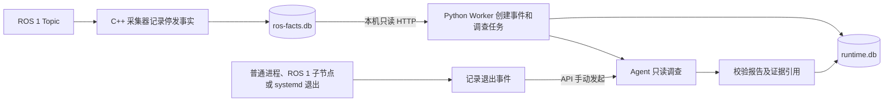

# RobotOps Agent

**面向机器人应用的本地故障监测与证据诊断系统。**

RobotOps 监测已登记的应用。ROS 1 Topic 停发时，C++ 采集器记录现场事实，Python Worker 自动创建故障事件并发起只读调查。报告的证据引用可以回查到这次停发的原始观测。

当前版本 **0.2.0** 支持三条接入路径：

| 场景 | 当前行为 |
|---|---|
| ROS 1 Noetic Topic 停发 | 自动采集事实、创建事件和调查任务，生成带证据的报告 |
| 普通命令、ROS 1 launch 或 systemd 服务异常退出 | 自动记录退出事件，可以通过 API 发起只读调查 |
| 本地 UDP pipeline | 可复现输入断流、处理停滞、配置不匹配和进程退出，提供无需模型密钥的离线回归 |

## 工作流程



- **两个 SQLite 文件。** C++ 管理 `ros-facts.db`，保存带时间和来源的现场事实。Python 管理 `runtime.db`，保存事件、任务、运行和证据索引。同一事实按来源和序号去重。
- **只读取证。** 默认单 Agent。手动调查可选层级式模式，将应用和系统检查分派给独立分支。工具网关验证参数、应用范围和证据归属，支持通过 SQLite FTS5 检索适用的历史案例。
- **调查可追溯。** 保存原始证据、逐轮模型输入、工具调用和用量。报告可以给出有证据支持的结论，亦可标记需要进一步研判。

## 快速开始

需要 **Linux、Python 3.11+**，以及支持 FTS5 和 JSON 函数的 SQLite。

### 安装

使用 uv 同步锁定依赖。

```bash
git clone --branch dev_zjh https://github.com/yishian6/RobotOps.git
cd RobotOps
uv sync --frozen --extra dev
```

也可以在已有 Python / conda 环境中执行 `python -m pip install -e '.[dev]'`，随后使用 `python` 和 `robotops` 命令运行。pip 按项目声明的版本范围解析依赖。

### 先跑离线演示

```bash
uv run python -m robotops_examples.pipeline smoke
uv run python -m robotops_benchmarks.e2e --provider scripted \
  --scenarios processing_stalled --strategies evidence --modes single --repeats 1
```

第一条命令验证真实子进程和观测工具。第二条命令用固定模型响应走完一次停滞调查，从采样、存证到报告。**两条命令均无需模型密钥，真实模型调用为零。**

### 启动服务

启动包含本地故障场景的示例服务。

```bash
uv run python -m robotops_examples.pipeline serve
```

服务默认监听 `127.0.0.1:8000`。使用 `uv run robotops serve` 可单独启动核心 API，示例进程及 `/demo` 路由由示例入口提供。[交互式 API 文档](http://127.0.0.1:8000/docs)

发起真实模型调查前，给服务进程提供 `DEEPSEEK_API_KEY`。如果密钥保存在本地 `.env`，可用 `uv run --env-file .env python -m robotops_examples.pipeline serve` 启动。

## 接入一个命令或 ROS 1 launch

在原启动命令前加 `robotops run 应用名 --`。普通程序在自己的工作目录运行，ROS 1 程序在已经加载 Noetic 和应用工作空间的终端运行。

```bash
robotops run image-worker -- python worker.py
robotops run litter-detector -- roslaunch litter_detection detect.launch
```

第一次执行会登记应用。命令的标准输出和标准错误显示在当前终端，并按启动实例保存在数据目录的 `executions/`。普通命令非零退出会生成事件。ROS 1 launch 中的子进程异常退出也会单独记事件。需要把本地 ROS 节点的输出显示在终端时，可以在原命令中加 `roslaunch --screen`。

终端打印的事件 ID 可用于查询详情和故障前的控制台输出。如启动入口与 API 在不同目录运行，在两个终端设定相同的绝对路径 `ROBOTOPS_DATA_DIR`。

```bash
curl -fsS "http://127.0.0.1:8000/incidents/${INCIDENT_ID}"
curl -fsS "http://127.0.0.1:8000/incidents/${INCIDENT_ID}/logs"
```

主动发起该事件的调查时，Agent 可以按关键词查询这份日志并引用原始证据。登记、运行和查看日志均可离线使用。

## 监测已有 Linux 服务

分别启动核心 API 和监测进程。两者使用同一个数据目录。

```bash
# 终端一
uv run robotops serve

# 终端二
uv run robotops monitor
```

登记一个已存在的 systemd 服务。以下以当前用户的服务为例，将单元名换成自己的服务名。

```bash
curl -fsS -X POST http://127.0.0.1:8000/services \
  -H 'Content-Type: application/json' \
  -d '{"unit":"my-worker.service","scope":"user"}'
curl -fsS http://127.0.0.1:8000/services
curl -fsS http://127.0.0.1:8000/incidents
```

系统级服务使用 `"scope":"system"`，也是默认值。对于用户级服务，API 和监测进程应由能访问同一用户管理器的账号运行。可以用 `robotops monitor --once` 手动读一次。服务观察到正常运行后，出现 systemd 明确标记的意外退出就自动建事件。持续异常更新同一事件，读取失败保留最后有效观测。

监测全程无需模型密钥。可在有 systemd 用户总线的 Linux 上运行实机验收，脚本使用独立的临时服务和数据目录。

```bash
uv run python -m robotops_examples.systemd_smoke
```

## 用 ROS 1 Topic 触发自动调查

先用上面的 `robotops run` 接入应用并启动它的 ROS 1 launch。各终端使用同一个 `ROS_MASTER_URI`。下面以已登记的 `camera` 和 `/camera/image_raw` 为例，替换成实际应用 ID 和一个**应持续更新**的 Topic。

### 构建并启动 C++ 采集器

```bash
source /opt/ros/noetic/setup.bash
cmake -S cpp/ros1_facts -B build/ros1_facts -DPYTHON_EXECUTABLE=/usr/bin/python3
cmake --build build/ros1_facts --parallel 2
mkdir -p data

# 应用名、Topic、静默阈值（ms）、本机端口、C++ 事实库
build/ros1_facts/robotops_ros1_facts camera /camera/image_raw 2000 8081 data/ros-facts.db
```

构建需要 C++17、CMake 3.16+、Noetic 的 `roscpp` 和 `topic_tools`，以及 SQLite3、Boost.System 和 nlohmann/json 的开发文件。采集器收到第一条消息后开始监测，每次连续静默只记录一条事实。HTTP 监听在 `127.0.0.1`。

### 启动自动调查并查看结果

在同一个仓库目录的另一个终端启动 Worker。以下命令从本地 `.env` 加载 `DEEPSEEK_API_KEY`。如果密钥已经导出到环境变量，使用 `uv run robotops watch-ros-facts …` 即可。

```bash
uv run --env-file .env robotops watch-ros-facts camera --port 8081 --max-model-calls 6
```

在隔离测试应用中暂停该 Topic 的发布。Worker 会自动派发调查，并在完成后输出运行记录。核心 API、应用启动入口和 Worker 共用同一个 `ROBOTOPS_DATA_DIR`。启动 `uv run robotops serve` 之后，可以按下表查回完整链路。

| 查询 | 内容 |
|---|---|
| `GET :8000/incidents` | 事件列表和事件 ID |
| `GET :8000/incidents/{id}` | 触发事实、自动任务状态和 `automatic_run_id` |
| `GET :8000/runs/{run_id}` | 报告、运行状态或错误 |
| `GET :8000/runs/{run_id}/evidence/{evidence_id}` | 报告引用的存证原文 |
| `GET :8081/v1/event/{sequence}` | C++ 事实库中同一条原始观测 |

自动调查默认最多调用模型六次。停发事实说明采集器在给定窗口内没有收到消息，根因需要结合其他现场证据研判。

## 使用模型调查

启动示例服务后，在另一个终端执行。前几步仅在本地布置故障和创建事件，`/investigate` 会调用真实模型，一次调查可能包含多轮请求。

```bash
# 启动数据生产与处理进程，并注册示例应用。
curl -sS -X POST http://127.0.0.1:8000/demo/start

# 注入处理停滞，生产端继续发送，处理端停止输出。
curl -sS -X POST http://127.0.0.1:8000/demo/fault \
  -H 'Content-Type: application/json' \
  -d '{"mode":"processing_stalled"}'

# 创建异常事件，返回结果中的 id 用于发起调查。
curl -sS -X POST http://127.0.0.1:8000/incidents \
  -H 'Content-Type: application/json' \
  -d '{"app_id":"pipeline","symptom":"应用没有持续输出，请调查原因"}'

# 替换为上一步返回的事件 ID。此请求会调用真实模型。
INCIDENT_ID="<事件ID>"
curl -sS -X POST "http://127.0.0.1:8000/incidents/${INCIDENT_ID}/investigate"
```

调查接口同步返回运行记录。可在请求 URL 上加 `?mode=...` 来选择调查模式。

| 模式 | 行为 |
|---|---|
| `single`，HTTP 默认 | 一个 Agent 直接查进程、指标、日志或配置，再提交报告 |
| `supervised` | 主 Agent 负责分派和汇总，应用与系统分支负责现场取证，用于 M1 层级式对照 |

先看运行的 `state`。`COMPLETED` 表示报告已通过校验。报告的 `status` 是 `proposed`（已有受支持的假设）或 `needs_human`（需人工研判）。再从 `report.hypotheses[].evidence_ids` 取证据 ID，用本次运行的 `id` 查询原始观测。

| 接口 | 内容 |
|---|---|
| `GET /runs/{id}` | 调查状态以及报告或错误详情 |
| `GET /runs/{id}/trace` | 模型响应、工具调用、分派理由与子任务结果 |
| `GET /runs/{id}/evidence/{evidence_id}` | 原始证据与完整性校验信息 |
| `GET /runs/{id}/memory` | 工作记忆和受保护的证据引用 |
| `GET /runs/{id}/contexts`、`GET /runs/{id}/contexts/{sequence}` | 快照索引，或按轨迹中的 `context_sequence` 查对应模型输入 |
| `GET /runs/{id}/usage` | 整次调查和 `by_role` 下的分角色请求数、实报 Token、缓存与缺失用量 |

其他故障模式包括 `input_stopped`、`config_mismatch` 和 `processor_exit`。演示结束后执行 `curl -sS -X DELETE http://127.0.0.1:8000/demo` 清理本地子进程，已保存的调查记录仍可查询。

## 配置

配置优先级为 **环境变量 > TOML > 默认值**。TOML 中的相对路径以配置文件所在目录为基准。[运行配置](config/robotops.toml) · [配置加载代码](src/robotops/config.py)

| 环境变量 | 用途 / 默认值 |
|---|---|
| `DEEPSEEK_API_KEY` | 模型密钥，仅从环境读取 |
| `ROBOTOPS_CONFIG` | 配置文件，默认 `config/robotops.toml` |
| `ROBOTOPS_MODEL` | 模型名，默认 `deepseek-flash` |
| `ROBOTOPS_MODEL_BASE_URL` | 模型接口地址，默认 `https://api.deepseek.com` |
| `ROBOTOPS_MODEL_TRUST_ENV` | 是否继承系统代理和证书环境，默认 `false` |
| `ROBOTOPS_MODEL_TIMEOUT_SECONDS` | 单次模型请求的超时，默认 60 秒 |
| `ROBOTOPS_BRANCH_TIMEOUT_SECONDS` | 一批子任务的等待截止时长，默认 120 秒，主 Agent 可继续调查 |
| `ROBOTOPS_MONITOR_INTERVAL_SECONDS` | systemd 状态与 ROS 1 事实 Worker 的轮询间隔，默认 5 秒 |
| `ROBOTOPS_DATA_DIR` | 持久化目录，默认 `data/`，包含 SQLite 数据库、运行日志、原始证据和轨迹 |
| `ROBOTOPS_PROMPT_VERSION` | 基础调查提示词版本，默认 `v2` |
| `ROBOTOPS_CONTEXT_STRATEGY` | 上下文策略，可选 `evidence`（默认）、`full` 和 `rolling` |

两种模式共用调查模板，层级式另外加载主 Agent 和子 Agent 的角色提示词。模板与角色资源分别记录版本和内容指纹。[提示词资源](config/prompts/) · [层级式角色提示词](config/prompts/supervision/v1/roles.json)

## 项目结构

```text
cpp/ros1_facts/      # C++17 Topic 采集器、事实库和本机 HTTP
src/robotops/
  api.py           # 应用、事件、调查与回查接口
  runner.py        # 一条命令接入、前台输出与退出事件
  roslaunch_adapter.py  # ROS 1 Noetic 子进程退出事件
  tools.py         # 只读工具注册、校验与执行
  storage.py       # 服务登记、事件、调查状态和原始证据
  service_manager.py  # 读取 systemd 状态
  monitor.py       # 服务轮询与事件更新入口
  ros_facts.py     # 拉取 ROS 事实、去重和自动派发调查
  agent/
    workflow.py    # LangGraph 模型与工具循环、最终报告校验
    supervision.py # 角色权限、委派去重与结果合并
    context.py     # 证据装配与逐轮请求快照
config/            # 非敏感运行配置与版本化 Prompt
examples/pipeline/ # 独立本地场景、观测适配与故障注入
benchmarks/        # 上下文装配对照与端到端故障评测
tests/             # 核心逻辑、协议与场景集成测试
pyproject.toml     # 项目元数据与依赖声明
uv.lock            # 依赖锁文件
```

技术栈包括 **C++17、ROS 1 Noetic、Python、LangGraph、ChatDeepSeek、FastAPI 和 SQLite / FTS5**。

## 测试与实验

```bash
uv run pytest -q
uv run robotops check-prompts
uv run python -m robotops_benchmarks.context

# 构建 C++ 采集器并加载 Noetic 后，用临时 ROS master 做本地联调。
ROBOTOPS_ROS1_FACTS_BIN=build/ros1_facts/robotops_ros1_facts \
  uv run pytest -q tests/test_ros_facts.py

# 预览两个调查组合，无需密钥。
uv run python -m robotops_benchmarks.e2e --plan \
  --provider deepseek --scenarios processing_stalled --strategies evidence \
  --modes single,supervised --repeats 1
```

ROS 1 联调用真实 Topic 和固定模型响应验证「发布节点在线但停发 → C++ 保存事实 → Python 自动调查 → 证据回查」，真实模型调用为零。未提供 C++ 二进制时，pytest 会跳过真实 ROS 1 联调，继续运行 Python 回归。

上下文实验对照完整历史、滚动摘录和证据感知装配，记录 UTF-8 输入字节数、关键值保留和工具协议检查结果。真实模型费用需要另行对照实报输入、输出和缓存 Token。

端到端评测用真实子进程布置故障。`scripted` 用固定回复验证单 Agent 管线与评分逻辑，`--plan` 仅预览调查组合。离线回归覆盖两种调查模式，包括双分支等待、证据隔离和超时回收。真实模型的诊断质量和用量需用相同场景做对照。

## 后续方向

- 接入规则恢复、持久动作记录和独立功能验收。
- 在长调查中增加按需加载的排查 Skill 和上下文窗口管理。
- 增加周期运维报告，并验证 ROS 2 与实体设备的观测接入。

当前服务面向本地开发与验证，尚未提供远程访问鉴权或生产部署方案。
