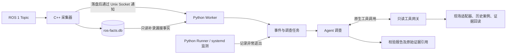

# RobotOps

面向机器人应用的本地故障监测、证据调查与受控恢复工具。C++ 在 ROS 1 侧记录 Topic 异常，Python 负责派发调查、执行只读工具和保存报告。操作员可以为特定 launch 启用一次异常退出重启，随后用原 Topic 的持续新消息验收。

**开发版本** `dev_zjh` 0.5.1　·　**已发布版本** `v0.5.0`

[项目技术文档](doc/RobotOps_技术文档.md) · [阶段汇报与实测](doc/RobotOps_当前版本汇报.md) · [上下文管理](doc/RobotOps_上下文管理.md)

## 系统怎么工作



- **感知。** ROS 1 采集器检测首条消息超时和发布后停发。普通命令、ROS launch 节点及已登记的 systemd 服务可记录异常退出。
- **调查。** 默认单 Agent。模型根据观测选择工具，Python 校验权限、执行并保存证据。长日志先预览再分页，历史按证据重要性装配。手动调查也支持主 Agent 分派应用和系统检查。
- **恢复。** 已启用重启的 ROS 1 launch 由 Runner 按原命令重启一次。新实例先通过进程稳定期，再按配置验收原 Topic。模型报告供研判，事件的恢复状态由实测回执决定。

## 快速开始

需要 Linux、Python 3.11+，以及支持 FTS5 和 JSON 函数的 SQLite。用 uv 从锁文件安装。

```bash
git clone --branch dev_zjh https://github.com/yishian6/RobotOps.git
cd RobotOps
uv sync --locked --extra dev
```

先跑隔离的 UDP 示例。它会创建真实子进程并验证故障观测，无需 ROS 或模型密钥。

```bash
uv run python -m robotops_examples.pipeline smoke
```

### 跑一次真实模型调查

在本地 `.env` 中提供 `DEEPSEEK_API_KEY`，启动示例 API。服务默认监听本机回环地址。

```bash
uv run --env-file .env python -m robotops_examples.pipeline serve
```

在另一个终端启动示例进程，注入处理停滞并创建事件。

```bash
curl -fsS -X POST http://127.0.0.1:8000/demo/start
curl -fsS -X POST http://127.0.0.1:8000/demo/fault \
  -H 'Content-Type: application/json' -d '{"mode":"processing_stalled"}'
curl -fsS -X POST http://127.0.0.1:8000/incidents \
  -H 'Content-Type: application/json' \
  -d '{"app_id":"pipeline","symptom":"生产端继续发送，处理端停止输出"}'
```

将上一步返回的 `id` 填入 `INCIDENT_ID`。调查请求会调用模型，清理命令会停止示例子进程。

```bash
INCIDENT_ID='<事件 ID>'
curl -fsS -X POST "http://127.0.0.1:8000/incidents/${INCIDENT_ID}/investigate"
curl -fsS -X DELETE http://127.0.0.1:8000/demo
```

只启动核心 API 时用 `uv run robotops serve`。示例和核心服务都可从本机打开交互式接口。 [API 文档](http://127.0.0.1:8000/docs)

## ROS 1 故障检测与恢复

### 构建采集器

构建需要 C++17、CMake 3.16+、Noetic 的 `roscpp` 和 `topic_tools`，以及 SQLite3、nlohmann/json 开发文件。

```bash
source /opt/ros/noetic/setup.bash
cmake -S cpp/ros1_facts -B build/ros1_facts -DPYTHON_EXECUTABLE=/usr/bin/python3
cmake --build build/ros1_facts --parallel 2
mkdir -p data
```

### 用 ROS 1 Topic 触发自动调查

各终端使用同一个 ROS Master 和数据目录。示例应用 `camera` 需先登记，可通过核心 API 的 `POST /applications` 提交 `{"app_id":"camera","components":["camera"]}`，也可使用之前已接入的应用。测首条消息时先启动 ROS Master、Worker 和采集器，再启动被测发布节点。

```bash
# 终端一，启动接收事实和调用模型的 Worker。
uv run --env-file .env robotops watch-ros-facts camera \
  --socket data/camera-ros-facts.sock --facts-db data/camera-ros-facts.db

# 终端二，加载 Noetic 后启动采集器。
build/ros1_facts/robotops_ros1_facts camera /camera/image_raw 2000 \
  data/camera-ros-facts.sock data/camera-ros-facts.db --startup-timeout-ms 10000
```

示例中，订阅后等不到首条消息的阈值是 **10 秒**，开始收到消息后的停发阈值是 **2 秒**。每个事实库绑定一个应用和一个 Topic，Worker 的 `--facts-db` 指向采集器写入的库。Python 将实时通知和只读回放按来源、序号去重。

自动调查默认最多 6 次模型请求。只收到完整的触发事实、缺少现场适配器且没有适用案例时，首轮直接提交报告。适用的 Topic Skill 随系统消息下发，名称和指纹可在 Trace 查到。 [首次请求与工具流转](doc/RobotOps_上下文管理.md#ros-1-自动调查的首次请求)

### 为一个独立的 ROS 1 launch 启用一次重启

在加载 Noetic 和应用工作空间的终端，用原 launch 命令接入。

```bash
uv run robotops run --restart-on-exit camera -- roslaunch camera_driver camera.launch
```

launch 异常结束时，Runner 按原参数重启一次。故障前的控制台片段、退出码和新旧启动编号可随原事件回查。只记录普通命令退出时，可用 `uv run robotops run image-worker -- python worker.py`。

### 验收重启后的原 Topic

在同一条命令上指定实际的输出 Topic 和已构建的采集器。

```bash
uv run robotops run --restart-on-exit --verify-topic /camera/image_raw \
  --ros-facts-bin build/ros1_facts/robotops_ros1_facts camera -- \
  roslaunch camera_driver camera.launch
```

重启的 launch 稳定后，C++ 检查同一发布节点的连续新消息，跳过首条锁存回放。允许的消息间隔取契约的 `health.max_output_silence_seconds`，默认 1 秒。连续窗口至少 5 秒，且至少是允许间隔的三倍。可在事件详情的 `launch_restart.topic_acceptance` 查看验收结果。只有 `PASSED` 会把关联退出事件转为 `RESOLVED`。 [真实 Noetic 验收](doc/RobotOps_当前版本汇报.md#m4-重启后的-topic-业务验收)

### 监测已有 systemd 服务

先启动核心 API，再登记已有服务。下面以用户级服务为例，替换为自己的单元名。

```bash
curl -fsS -X POST http://127.0.0.1:8000/services \
  -H 'Content-Type: application/json' -d '{"unit":"my-worker.service","scope":"user"}'
uv run robotops monitor
```

系统服务使用 `scope=system`。监测器记录状态和异常退出，可用 `--once` 查询一轮。

## 数据和证据怎么查

默认数据目录为 `data/`。服务、Runner 和 Worker 若从不同目录启动，请统一设置绝对路径 `ROBOTOPS_DATA_DIR`。

| 数据 | 位置 |
|---|---|
| ROS 1 来源和触发事实 | C++ 写入独立的 `ros-facts.db`，路径由采集器参数指定 |
| 事件、任务、验收回执、报告、工作记忆和快照 | Python 的 `runtime.db` |
| 普通观测原文 | `evidence/`，SQLite 索引保留运行归属和 SHA-256 |
| 模型与工具轨迹、受管进程控制台 | `traces/` 和 `executions/` |

从 `GET /incidents/{id}` 查触发事实和恢复回执，自动调查的运行 ID 在 `automatic_run_id`。用 `GET /runs/{run_id}` 看报告，用该运行下的 `/evidence/{evidence_id}` 回查原始证据。查看 `/trace` 中的 `context_sequence`，再查 `/contexts/{sequence}` 可还原模型当轮实际输入。运行 `COMPLETED` 表示报告已交付，事件 `RESOLVED` 表示原 Topic 的恢复验收通过。

常用配置包括 `DEEPSEEK_API_KEY`、`ROBOTOPS_MODEL`、`ROBOTOPS_DATA_DIR` 和 `ROBOTOPS_CONTEXT_COMPACT_AFTER_TOKENS`。配置优先级为环境变量、TOML、默认值。默认输入估算裁剪阈值为 131,072 Token，模型总窗口单独配置。 [运行配置](config/robotops.toml) · [窗口与快照细节](doc/RobotOps_上下文管理.md#6-m5-请求前的窗口裁剪)

### 可选 Redis 分页缓存

SQLite 核对证据归属，文件保存原文。Redis 暂存已校验的日志分页。命中仍核对归属和文件身份，缓存不可用时回读原文。

```bash
uv sync --locked --extra dev --extra redis
export ROBOTOPS_REDIS_CACHE_URL=redis://127.0.0.1:6379/0
uv run --no-sync robotops serve
```

## 测试与实验

```bash
uv run pytest -q -rs
uv run robotops check-prompts
uv run python -m robotops_benchmarks.context
uv run python -m robotops_benchmarks.e2e --provider scripted \
  --scenarios processing_stalled --strategies evidence --modes single --repeats 1

# 构建采集器并加载 Noetic 后跑全套。
ROBOTOPS_ROS1_FACTS_BIN="$PWD/build/ros1_facts/robotops_ros1_facts" \
  uv run pytest -q -rs
```

| 本地验证 | 结果 |
|---|---|
| 普通环境回归 | 123 项通过，11 项因需要 Noetic 而跳过 |
| Noetic 全量回归 | 134 项通过，0 项跳过 |
| DeepSeek 首条消息超时 | 同场景修复后 4 次请求降为 1 次，输入从 12,061 降至 2,093 Token。 [复测](doc/RobotOps_当前版本汇报.md#同场景修复复测) |
| SQLite + Redis 热分页 | 同一份 200 行日志两条路径各回读 840 次，批次平均单次耗时的中位数从 1.621 ms 降到 0.757 ms。 [测量口径](doc/RobotOps_技术文档.md#redis-命中时省掉了什么) |

## GitHub Actions 与发布

| 触发 | 检查 |
|---|---|
| 推送 `dev_zjh` 或 `main` | `quality` 跑锁定依赖、Ruff、pytest、提示词检查和离线基准。 `package` 构建 wheel/sdist，检查资源与禁止文件，并在仓库外安装 wheel 检查 Prompt 和 Skill。 [CI](.github/workflows/ci.yml) |
| PR 发往 `main` | `quality`、`package` 和 `noetic`。Noetic 在容器里构建 C++ 采集器并要求零跳过，也可手动运行；每天北京时间 02:00 另有一次定时运行。 [Noetic](.github/workflows/ros1-noetic.yml) |
| 手动推送 `v*` 标签 | 核对 tag、包与运行时版本及提交是否已合入 `main`，在 tag 上重跑快速检查，用 `uv.lock` 安装依赖并复用同一归档检查，发布 wheel/sdist 和 `SHA256SUMS`。 [Release](.github/workflows/release.yml) |

首个 PR 产生检查结果后，在 `main` 的分支保护或 Ruleset 中要求通过 PR、禁止绕过，要求 PR 分支与 `main` 同步，并将 `quality`、`package` 和 `noetic` 设为必过。维护者审核后手动合并，发版时再推送标签。 [GitHub 分支保护说明](https://docs.github.com/en/repositories/configuring-branches-and-merges-in-your-repository/managing-protected-branches/about-protected-branches)

## 项目结构

| 目录 | 职责 |
|---|---|
| `cpp/ros1_facts/` | ROS 1 采集、SQLite 落盘、本机通知和 Topic 验收 |
| `src/robotops/` | API、Runner、事实 Worker、存储和工具网关 |
| `src/robotops/agent/` | LangGraph 调查循环、上下文、工作记忆、角色与报告校验 |
| `config/` | TOML、版本化 Prompt 和 ROS 1 Skill |
| `examples/`、`benchmarks/`、`tests/` | 可运行示例、对照实验与自动回归 |
