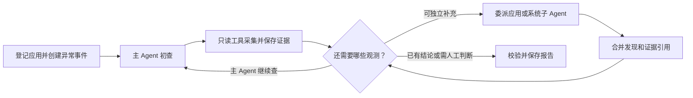

# RobotOps Agent

**面向机器人应用的运维 Agent。**

当应用没有持续输出时，RobotOps 可以检查上游是否还在发送、处理进程是否存活，以及样本是否一直未处理完。调用方登记应用、提交异常事件，Agent 用只读工具核查现场并返回带证据引用的诊断报告。

当前版本 **0.2.0 已完成 M1 只读调查闭环**。仓库提供两个通过本机 UDP 传输样本的真实子进程，可离线复现输入断流、处理停滞、配置不匹配和进程退出。持续监测、自动恢复及 ROS 2 接入属于后续阶段。

## 工作流程



- **按需委派。** 主 Agent 先取证。需要独立补充观测时，应用分支查指标、日志和配置，系统分支查进程。分支使用独立上下文，通过结构化发现与证据引用交付结果。后端按工具名和参数跳过重复委派。
- **证据可回查。** 工具网关校验参数和应用范围，通过观测适配器读取现场数据，并在返回模型前保存原文。历史案例可通过 SQLite FTS5 检索，当前故障判断需要本次调查的观测支持。
- **逐轮保存模型输入。** 上下文装配保留近期完整的工具调用和回复，整理重复的历史观测与日志，保护支持和反对假设的引用。每轮实际发送内容、工具定义及用量可回查。

## 快速开始

需要 **Linux、Python 3.11+**，以及支持 FTS5 和 JSON 函数的 SQLite。

### 安装

使用 uv 同步锁定依赖。

```bash
git clone https://github.com/yishian6/RobotOps.git
cd RobotOps
uv sync --frozen --extra dev
```

也可以在已有 Python / conda 环境中执行 `python -m pip install -e '.[dev]'`，随后使用 `python` 和 `robotops` 命令运行。pip 按项目声明的版本范围解析依赖。

### 先跑离线演示

```bash
uv run python -m robotops_examples.pipeline smoke
uv run python -m robotops_benchmarks.e2e --provider scripted \
  --scenarios processing_stalled --strategies evidence --modes single --repeats 1
```

第一条命令验证真实子进程和观测工具。第二条命令用固定模型响应走完一次停滞调查，从采样、存证到报告。**两条命令均无需模型密钥，真实模型调用为零。**

### 启动服务

启动包含本地故障场景的示例服务。

```bash
uv run python -m robotops_examples.pipeline serve
```

服务默认监听 `127.0.0.1:8000`。使用 `uv run robotops serve` 可单独启动核心 API，示例进程及 `/demo` 路由由示例入口提供。[交互式 API 文档](http://127.0.0.1:8000/docs)

发起真实模型调查前，给服务进程提供 `DEEPSEEK_API_KEY`。如果密钥保存在本地 `.env`，可用 `uv run --env-file .env python -m robotops_examples.pipeline serve` 启动。

## 使用模型调查

启动示例服务后，在另一个终端执行。前几步仅在本地布置故障和创建事件，`/investigate` 会调用真实模型，一次调查可能包含多轮请求。

```bash
# 启动数据生产与处理进程，并注册示例应用。
curl -sS -X POST http://127.0.0.1:8000/demo/start

# 注入处理停滞，生产端继续发送，处理端停止输出。
curl -sS -X POST http://127.0.0.1:8000/demo/fault \
  -H 'Content-Type: application/json' \
  -d '{"mode":"processing_stalled"}'

# 创建异常事件，返回结果中的 id 用于发起调查。
curl -sS -X POST http://127.0.0.1:8000/incidents \
  -H 'Content-Type: application/json' \
  -d '{"app_id":"pipeline","symptom":"应用没有持续输出，请调查原因"}'

# 替换为上一步返回的事件 ID。此请求会调用真实模型。
INCIDENT_ID="<事件ID>"
curl -sS -X POST "http://127.0.0.1:8000/incidents/${INCIDENT_ID}/investigate"
```

调查接口同步返回运行记录。可在请求 URL 上加 `?mode=...` 来选择调查模式。

| 模式 | 行为 |
|---|---|
| `adaptive`，HTTP 默认 | 主 Agent 先直接查，出现独立取证需求时再启动子 Agent |
| `single` | 一个 Agent 完成取证和报告，用于单 Agent 对照 |
| `supervised` | 主 Agent 负责分派和汇总，应用与系统分支负责现场取证，用于 M1 层级式对照 |

先看运行的 `state`。`COMPLETED` 表示报告已通过校验。报告的 `status` 是 `proposed`（已有受支持的假设）或 `needs_human`（需人工研判）。再从 `report.hypotheses[].evidence_ids` 取证据 ID，用本次运行的 `id` 查询原始观测。

| 接口 | 内容 |
|---|---|
| `GET /runs/{id}` | 调查状态以及报告或错误详情 |
| `GET /runs/{id}/trace` | 模型响应、工具调用、分派理由与子任务结果 |
| `GET /runs/{id}/evidence/{evidence_id}` | 原始证据与完整性校验信息 |
| `GET /runs/{id}/memory` | 工作记忆和受保护的证据引用 |
| `GET /runs/{id}/contexts`、`GET /runs/{id}/contexts/{sequence}` | 快照索引，或按轨迹中的 `context_sequence` 查对应模型输入 |
| `GET /runs/{id}/usage` | 实报的输入、输出和缓存 Token，以及用量缺失情况 |

其他故障模式包括 `input_stopped`、`config_mismatch` 和 `processor_exit`。演示结束后执行 `curl -sS -X DELETE http://127.0.0.1:8000/demo` 清理本地子进程，已保存的调查记录仍可查询。

## 配置

配置优先级为 **环境变量 > TOML > 默认值**。TOML 中的相对路径以配置文件所在目录为基准。[运行配置](config/robotops.toml) · [配置加载代码](src/robotops/config.py)

| 环境变量 | 用途 / 默认值 |
|---|---|
| `DEEPSEEK_API_KEY` | 模型密钥，仅从环境读取 |
| `ROBOTOPS_CONFIG` | 配置文件，默认 `config/robotops.toml` |
| `ROBOTOPS_MODEL` | 模型名，默认 `deepseek-flash` |
| `ROBOTOPS_MODEL_BASE_URL` | 模型接口地址，默认 `https://api.deepseek.com` |
| `ROBOTOPS_MODEL_TRUST_ENV` | 是否继承系统代理和证书环境，默认 `false` |
| `ROBOTOPS_MODEL_TIMEOUT_SECONDS` | 单次模型请求的超时，默认 60 秒 |
| `ROBOTOPS_DATA_DIR` | 持久化目录，默认 `data/`，包含 SQLite 数据库、原始证据和轨迹 |
| `ROBOTOPS_PROMPT_VERSION` | 基础调查提示词版本，默认 `v2` |
| `ROBOTOPS_CONTEXT_STRATEGY` | 上下文策略，可选 `evidence`（默认）、`full` 和 `rolling` |

基础调查模板和角色提示词分别记录版本与内容指纹。当前默认按需模式使用 `adaptive/v2` 的角色提示词。[提示词资源](config/prompts/) · [按需角色提示词](config/prompts/adaptive/v2/roles.json)

## 项目结构

```text
src/robotops/
  api.py           # 应用、事件、调查与回查接口
  tools.py         # 只读工具注册、校验与执行
  storage.py       # 调查状态、原始证据与轨迹
  agent/
    workflow.py    # LangGraph 模型与工具循环、最终报告校验
    supervision.py # 角色权限、委派去重与结果合并
    context.py     # 证据装配与逐轮请求快照
config/            # 非敏感运行配置与版本化 Prompt
examples/pipeline/ # 独立本地场景、观测适配与故障注入
benchmarks/        # 上下文装配对照与端到端故障评测
tests/             # 核心逻辑、协议与场景集成测试
pyproject.toml     # 项目元数据与依赖声明
uv.lock            # 依赖锁文件
```

当前技术栈包括 **Python、LangGraph、ChatDeepSeek、FastAPI、SQLite / FTS5 和 uv**。

## 测试与实验

```bash
uv run pytest -q
uv run robotops check-prompts
uv run python -m robotops_benchmarks.context

# 预览两个调查组合，无需密钥。
uv run python -m robotops_benchmarks.e2e --plan \
  --provider deepseek --scenarios processing_stalled --strategies evidence \
  --modes single,adaptive --repeats 1
```

上下文实验对照完整历史、滚动摘录和证据感知装配，记录 UTF-8 输入字节数、关键值保留和工具协议检查结果。真实模型费用需要另行对照实报输入、输出和缓存 Token。

端到端评测用真实子进程布置故障。`scripted` 用固定回复验证单 Agent 管线与评分逻辑，`--plan` 仅预览调查组合。M1 已用真实模型验证停滞场景下的双分支取证与报告回查。新版 `adaptive/v2` 已通过离线回归，真实模型诊断质量和费用仍待对照。

## 后续方向

- 登记已有 Linux 服务，持续观测进程退出并生成事件。
- 接入规则恢复、持久动作记录和独立功能验收。
- 在长调查中增加按需加载的排查 Skill 和上下文窗口管理。
- 增加周期运维报告，并验证 ROS 2 与实体设备的观测接入。

当前服务面向本地开发与验证，尚未提供远程访问鉴权或生产部署方案。
