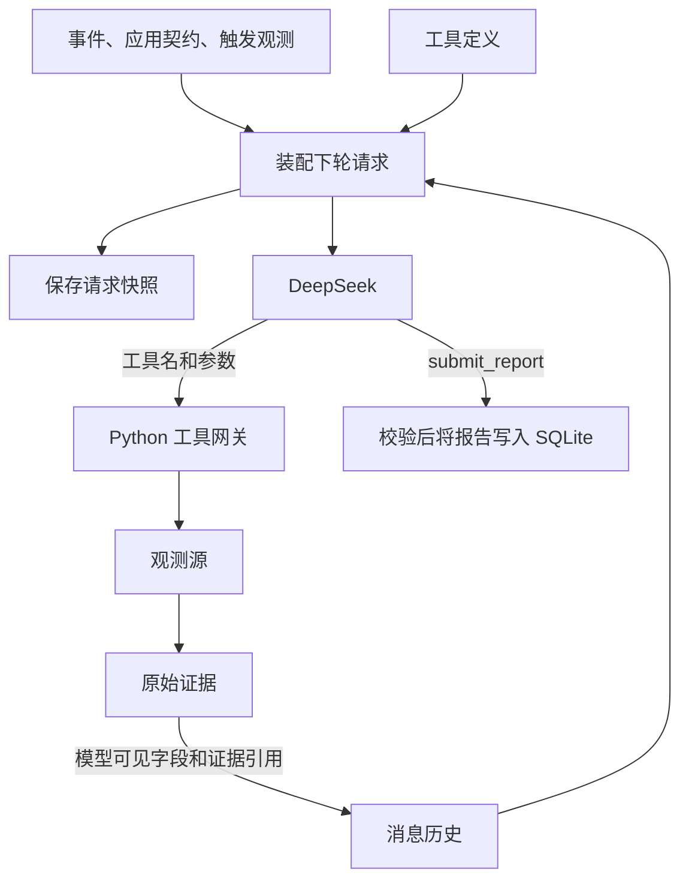

# RobotOps 上下文管理

这里说明现行代码每轮读取、发送和保存的数据。第 1–5 节的实测示例取自 2026-11-24 20:30（北京时间）的 DeepSeek Flash 调查，第 6 节记录 M5 的请求窗口与回归。

## 1. 从故障进入模型

以隔离 UDP 示例为例，初始消息带三组信息。

- **系统指令** 只读调查，区分证据支持与待查情况，通过 `submit_report` 提交。
- **任务数据** 应用 `pipeline`，症状「数据处理链路没有持续输出」，组件 `producer`、`processor`。契约给出最低输入速率 5 Hz、输出静默上限 1 秒和组件依赖。ROS 自动调查还会带上 Topic 静默事实和证据引用。
- **工具定义** 函数名、用途、参数 Schema。默认 v2 短单 Agent 调查直接使用任务里的契约，禁用记忆写入。层级模式或显式扩大请求预算的调查可以使用工作记忆。

## 2. 工具怎么产生新的信息

20:30 实测中，第 1、3 轮的 `query_metrics` 带采样秒数，返回采样窗口、每秒计数变化和当前进程遥测。以下是摘出的关键读数。

| 现场字段 | 第一次 | 第二次 |
|---|---:|---:|
| 发送端累计发送 | 106 | 182 |
| 处理端累计接收 / 完成 | 26 / 25 | 26 / 25 |
| 处理端当前样本耗时 | 4.047 秒 | 7.889 秒 |
| 处理端上次完成样本的耗时 | 0.0081 毫秒 | 0.0081 毫秒 |

同一个开始处理时间始终没变，而在途时长持续上涨。两次采样一起证明处理端有一条已经进入处理的样本没有完成。采样期间接收为零只表示接收计数未变，具体阻塞在哪个函数或通道还需要对应观测。

20:30 实测只调用一次 `search_logs`，返回两条启动日志。此前的 20:05 实测曾按 `processor` 和 `error` 重新查同一批内容，没有得到新线索。当前工具参数中已移除 `refresh`。首次未过滤、未截断且读完的日志形成覆盖边界。后续未指定 `since`，或指定更早起点时，返回原证据 ID、采集时间和复用说明。真正需要看后续日志时，用原结果的 `observed_at` 或更晚时间作 `since`。窗口被截断、日志读取不完整或原证据对当前角色不可见时，仍按请求读取。 [工具实现](../src/robotops/tools.py)

## 3. 每轮实际给模型什么

1. `assemble` 取系统指令、任务、已发生的助手消息和工具回传，以及可用的工作记忆。
2. 默认 `evidence` 保留最新一批完整工具往返。更早的日志可聚合，已归纳或重复的证据可用引用。保护中的关键证据和反证继续保留。
3. 比较候选与原消息数组的 UTF-8 字节数。候选更大就发送完整历史。工具符号和 Schema 独立于消息数组发送。
4. 发送前记录准确快照。模型输出后存公开正文与工具调用。报告工具成功时结束，最后回执只在 Trace，不再请求模型。

20:30 实测四轮都发送了完整历史，第 3、4 轮整理候选更大。第 4 轮收到 11 条消息和 7 个工具定义，消息数组为 11,710 B，供应商实报输入为 5,428 Token。两者计量口径不同。 [装配实现](../src/robotops/agent/context.py)

### 工作记忆

长调查可显式写入事实、证据引用、假设、支持与反对引用、焦点组件和待查事项。程序检查引用的归属与可见范围，新版本继承原有的保护引用。回执仅返回 `status`、`version` 和 `protected_ids`。

20:05 实测模型把「发送端仍在发送」「处理端在途样本持续时间增长」写入记忆，下一轮马上交报告，回执 166 B。现行短调查不再提供这次独立写入，模型即使发出调用也会收到拒绝，不创建记忆版本。 [记忆表实现](../src/robotops/agent/memory.py)

## 4. 数据实际放在哪

| 写入内容 | 位置 | 如何查 |
|---|---|---|
| 原始工具观测 | `runtime.db` 的 `evidence` 保存索引，普通原文放在 `evidence/<证据编号>.json` | `GET /runs/{id}/evidence/{eid}` |
| ROS 触发事实 | `runtime.db` 的 `ros_fact_tasks.fact`，按证据索引读取 | 同一证据接口 |
| 工作记忆 | `memories` 按运行和版本存正文 | `GET /runs/{id}/memory` |
| 各轮真实请求 | `context_snapshots` 存顺序、引用、清单与哈希，正文在 `context_messages`，系统指令与工具定义在 `context_inputs` | `GET /runs/{id}/contexts/{sequence}` |
| 模型回复、工具和实报用量 | `traces/<运行编号>.jsonl`，工具参数由同轮模型响应追溯 | `GET /runs/{id}/trace`、`GET /runs/{id}/usage` |
| 最终报告 | `runs.report` | `GET /runs/{id}` |

快照查询把引用拼回原消息顺序，通过 SHA-256 检查。旧快照可以照原格式读取。本次实测的本地数据库是 `data/real-context-short-20261124-203009-520264/data/runtime.db`。同目录的 `traces/` 可查供应商用量和各轮工具往返，运行产物保存在本机。

## 5. 当前实测和窗口边界

手动调查默认 8 次请求，ROS 自动调查默认 6 次。层级调查的主、子分支共享总额度，主 Agent 保留一轮交报告。连续三批工具未提供新线索会提前收尾。进展按观测内容判断。日志窗口缩小、原文回读、子分支换证据编号或采样时间变化均可识别为重复。在途时长、计数或实例实际变化仍可提供新线索。 [预算及无进展规则](../src/robotops/agent/graph.py) · [观测签名](../src/robotops/agent/recovery.py)

`trace` 的 `model_budget` 事件记录每次额度申请是否获准、总额度、已占用和剩余额度，以及收尾原因。请求快照清单保存同一轮的额度与连续无进展批数。`/usage` 的 `model_budget` 汇总这些记录，供应商实报用量仍在原有字段。额度在组装请求前占用，因此即使快照写入失败，也可区分已占额度和实际模型回包。 [用量汇总](../src/robotops/agent/usage.py)

ROS 1 自动调查的新实测从停机期间落盘的 Topic 事实开始，输入 7,405 Token、输出 2,177 Token，三轮交付引用原始观测的 `needs_human` 报告。 [回放触发的自动实测](RobotOps_当前版本汇报.md#040-自动-topic-实测)

同期独立 UDP 取证实测中第 4 轮交报告，状态为 `proposed`，五项评估通过。报告定位到已进入处理流程的一条样本持续未完成，建议人工检查线程栈和通道。

| 指标 | 20:05 对照 | 20:30 UDP 实测 |
|---|---:|---:|
| 模型请求 | 6 | 4 |
| 实际日志读取 | 3 | 1 |
| 指标采样 | 2 | 2 |
| 工作记忆写入 | 1 | 0 |
| 输入 Token | 33,500 | 16,167 |
| 总耗时 | 30.18 秒 | 16.62 秒 |

本次输入 Token 较上一轮少 51.7%。两次为同场景独立实测，工具选择和采样窗口有变化。按 [评测命令](../README.md#测试与实验) 可重新运行。

## 6. M5 请求前的窗口裁剪

消息和当前实际开放的工具 Schema 的估算输入超过 **131,072** 时，触发窗口裁剪。可用 `ROBOTOPS_CONTEXT_COMPACT_AFTER_TOKENS` 调整。估算使用紧凑 JSON 的 UTF-8 字节数和协议余量，供应商实报 Token 从 `/usage` 查询。

模型总窗口独立计算。官方 `deepseek-flash` 的总窗口为 1,048,576 Token。RobotOps 当前使用非思考模式，省略 `max_tokens` 时，DeepSeek 的默认生成上限为 8,192，预检仅在核对模型的总窗口时用到这个值。显式设置 `ROBOTOPS_MODEL_OUTPUT_TOKENS` 才在请求里覆盖生成上限。自定义端点可用 `ROBOTOPS_CONTEXT_WINDOW_TOKENS` 告知模型总窗口；模型总窗口未知时，以配置的输入阈值作为本地上限。 [DeepSeek 模型容量](https://api-docs.deepseek.com/api/list-models/) · [生成参数](https://api-docs.deepseek.com/api/create-chat-completion/)

| 顺序 | 请求内容如何变化 |
|---|---|
| 正常发送 | 原有 `full`、`rolling`、`evidence` 先生成历史视图。估算能放下时直接使用。 |
| 整理旧历史 | 省去旧助手草稿，把可回查的历史证据放进结构化归档，每个证据 ID 留一份记录。保留工具名、短参数、原文引用和可保留的短观测。 |
| 缩小近期工具结果 | 省去工具调用附带的助手草稿，将有原文证据的大结果缩成引用与必要的观测字段。指标保留各组件速率、输出时间和在途耗时，进程观测保留存活状态和实例。工具调用及回复保持配对。 |
| 保护原文回读 | 最近一批 `read_evidence` 回复优先保留完整原文。只有请求仍超过模型可用输入上限时，才缩小回读结果，保留可提取的诊断字段，并明确提示当前窗口内正文不完整。 |
| 收尾 | 每一级都按同一口径重算。缩小后仍超过压缩阈值、但在模型可用输入上限内的请求仍可发送。超过输入上限时，只开放当前角色的报告工具再做预检；仍放不下时，使用已有证据本地生成 `needs_human` 报告，分支返回 `blocked`。 |

系统指令、用户任务和原始工具 Schema 仍按原文使用，收尾只缩小可用工具集合。工作记忆里的支持证据、反证和保护引用原样保留。裁剪只生成本轮发送视图，原始历史和证据可从原有 SQLite 索引与证据文件回查。越过预算时，程序会参考最新工具批次的大小争取为下一批留空间，可继续缩小的载荷有限时按输入上限判断能否发送。这一阶段用规则生成归档，整个回归没有额外的压缩请求。 [请求装配与复核](../src/robotops/agent/context.py) · [调查收尾](../src/robotops/agent/graph.py)

`GET /runs/{id}/contexts/{sequence}` 的 `manifest.context_window` 显示压缩阈值、模型总窗口、可用输入上限、估算前后占用、模型窗口余量和实际使用的裁剪阶段。完全在本地收尾时，这些信息记在 `model_budget` 轨迹事件中。 [请求快照接口](../README.md#使用模型调查)

### 长调查离线回归

固定轨迹的基础装配对照显示，重复日志场景中，滚动摘录与证据感知装配相对完整历史分别减少 53.1% 和 56.0% 的请求字节。短调查中的证据策略保留原视图，字节数持平。参数变体场景中，滚动摘录省去了其中一个关键参数值，证据感知装配通过全部保留检查。具体比例会随输入而变。 [装配对照入口](../README.md#测试与实验)

回归通过 ChatDeepSeek SDK 发送到离线传输替身。测试输入阈值设为 14,952，模型总窗口设为 17,000，显式生成上限设为 2,048。第二次取证得到 110 行日志，令第 3 次请求超限。下表记录的是预检的估算值。

| 请求 | 估算压缩前 | 复核后 | 剩余空间 |
|---|---:|---:|---:|
| 1 | 8,657 | 8,657 | 6,295 |
| 3 | 59,095 | 10,076 | 4,876 |
| 4 | 63,615 | 10,497 | 4,455 |
| 7 | 77,175 | 11,760 | 3,192 |

第 3 次请求缩小后继续发送了 4 次请求，最终报告引用 6 份观测，110 行原始日志按证据 ID 回查。回归还验证了支持与反对证据、追加用户约束和工具调用配对，以及两种窗口不足的收尾。 [M5 回归用例](../tests/test_context_window.py)

### 真实进程与 DeepSeek 压力复测

2026-11-25 用本机 UDP 子进程制造处理停滞，将估算输入阈值降到 12,000。首次调查中，裁剪移除了指标的嵌套速率和进程状态，6 次原文回读也没有把这些值送回模型，最后用尽 8 次请求，由本地生成 `needs_human` 报告。

修复后用同一场景和阈值复测。裁剪后的指标仍包含生产端约 19.5–20 Hz、处理完成速率 0 Hz，以及同一条在途消息从约 3.0 秒增加到 22.1 秒的记录。两次原文回读都完整发送，第 8 次请求提交 `proposed` 报告，定位到处理端有在途消息长期未完成。报告的 9 条证据引用均可回查，基准 5 项检查通过。本轮验证的是裁剪后能否完成诊断，模型实报输入 45,781 Token、输出 2,254 Token。 [回归用例](../tests/test_context_window.py)
