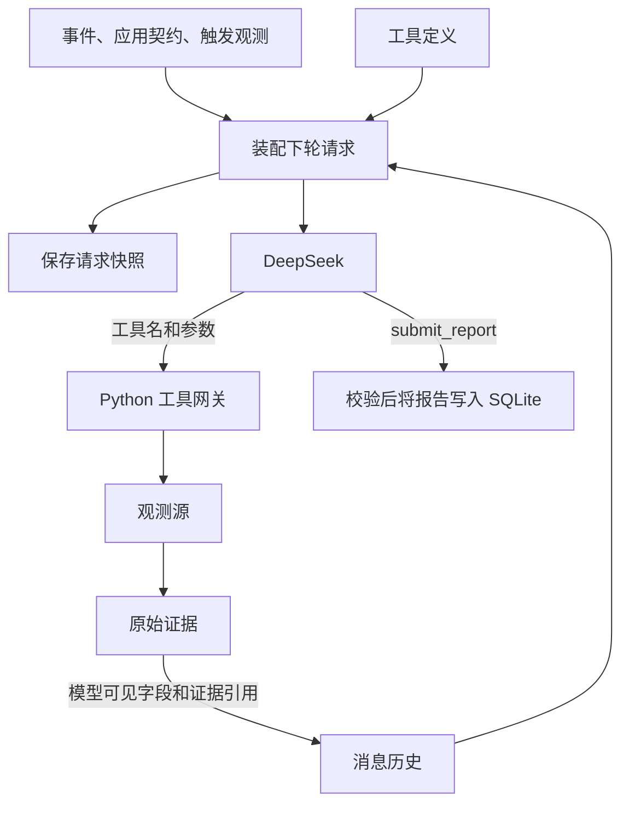

# RobotOps 上下文管理

更新于 2026-11-24。这里说明现行代码每轮读取、发送和保存的数据。示例取自当天 20:30（北京时间）的 DeepSeek Flash 实测。

## 1. 从故障进入模型

以隔离 UDP 示例为例，初始消息带三组信息。

- **系统指令** 只读调查，区分证据支持与待查情况，通过 `submit_report` 提交。
- **任务数据** 应用 `pipeline`，症状「数据处理链路没有持续输出」，组件 `producer`、`processor`。契约给出最低输入速率 5 Hz、输出静默上限 1 秒和组件依赖。ROS 自动调查还会带上 Topic 静默事实和证据引用。
- **工具定义** 函数名、用途、参数 Schema。默认 v2 短单 Agent 调查直接使用任务里的契约，禁用记忆写入。层级模式或显式扩大请求预算的调查可以使用工作记忆。

## 2. 工具怎么产生新的信息

20:30 实测中，第 1、3 轮的 `query_metrics` 带采样秒数，返回采样窗口、每秒计数变化和当前进程遥测。以下是摘出的关键读数。

| 现场字段 | 第一次 | 第二次 |
|---|---:|---:|
| 发送端累计发送 | 106 | 182 |
| 处理端累计接收 / 完成 | 26 / 25 | 26 / 25 |
| 处理端当前样本耗时 | 4.047 秒 | 7.889 秒 |
| 处理端上次完成样本的耗时 | 0.0081 毫秒 | 0.0081 毫秒 |

同一个开始处理时间始终没变，而在途时长持续上涨。两次采样一起证明处理端有一条已经进入处理的样本没有完成。采样期间接收为零只表示接收计数未变，具体阻塞在哪个函数或通道还需要对应观测。

20:30 实测只调用一次 `search_logs`，返回两条启动日志。此前的 20:05 实测曾按 `processor` 和 `error` 重新查同一批内容，没有得到新线索。当前工具参数中已移除 `refresh`。首次未过滤、未截断且读完的日志形成覆盖边界。后续未指定 `since`，或指定更早起点时，返回原证据 ID、采集时间和复用说明。真正需要看后续日志时，用原结果的 `observed_at` 或更晚时间作 `since`。窗口被截断、日志读取不完整或原证据对当前角色不可见时，仍按请求读取。 [工具实现](../src/robotops/tools.py)

## 3. 每轮实际给模型什么

1. `assemble` 取系统指令、任务、已发生的助手消息和工具回传，以及可用的工作记忆。
2. 默认 `evidence` 保留最新一批完整工具往返。更早的日志可聚合，已归纳或重复的证据可用引用。保护中的关键证据和反证继续保留。
3. 比较候选与原消息数组的 UTF-8 字节数。候选更大就发送完整历史。工具符号和 Schema 独立于消息数组发送。
4. 发送前记录准确快照。模型输出后存公开正文与工具调用。报告工具成功时结束，最后回执只在 Trace，不再请求模型。

20:30 实测四轮都发送了完整历史，第 3、4 轮整理候选更大。第 4 轮收到 11 条消息和 7 个工具定义，消息数组为 11,710 B，供应商实报输入为 5,428 Token。两者计量口径不同。 [装配实现](../src/robotops/agent/context.py)

### 工作记忆

长调查可显式写入事实、证据引用、假设、支持与反对引用、焦点组件和待查事项。程序检查引用的归属与可见范围，新版本继承原有的保护引用。回执仅返回 `status`、`version` 和 `protected_ids`。

20:05 实测模型把「发送端仍在发送」「处理端在途样本持续时间增长」写入记忆，下一轮马上交报告，回执 166 B。现行短调查不再提供这次独立写入，模型即使发出调用也会收到拒绝，不创建记忆版本。 [记忆表实现](../src/robotops/agent/memory.py)

## 4. 数据实际放在哪

| 写入内容 | 位置 | 如何查 |
|---|---|---|
| 原始工具观测 | `runtime.db` 的 `evidence` 保存索引，普通原文放在 `evidence/<证据编号>.json` | `GET /runs/{id}/evidence/{eid}` |
| ROS 触发事实 | `runtime.db` 的 `ros_fact_tasks.fact`，按证据索引读取 | 同一证据接口 |
| 工作记忆 | `memories` 按运行和版本存正文 | `GET /runs/{id}/memory` |
| 各轮真实请求 | `context_snapshots` 存顺序、引用、清单与哈希，正文在 `context_messages`，系统指令与工具定义在 `context_inputs` | `GET /runs/{id}/contexts/{sequence}` |
| 模型回复、工具和实报用量 | `traces/<运行编号>.jsonl`，工具参数由同轮模型响应追溯 | `GET /runs/{id}/trace`、`GET /runs/{id}/usage` |
| 最终报告 | `runs.report` | `GET /runs/{id}` |

快照查询把引用拼回原消息顺序，通过 SHA-256 检查。旧快照可以照原格式读取。本次实测的本地数据库是 `data/real-context-short-20261124-203009-520264/data/runtime.db`。同目录的 `traces/` 可查供应商用量和各轮工具往返，运行产物保存在本机。

## 5. 当前实测和窗口边界

0.4.0 的手动调查默认 8 次请求，ROS 自动调查默认 6 次；层级调查的主、子分支共享总额度，主 Agent 保留一轮交报告。连续三批空结果、重复结果或其他没有新线索的工具回复会提前收尾。新的指标采样可用来证明在途时长继续增长。 [预算及无进展规则](../src/robotops/agent/graph.py)

ROS 1 自动调查的新实测从停机期间落盘的 Topic 事实开始，输入 7,405 Token、输出 2,177 Token，三轮交付引用原始观测的 `needs_human` 报告。 [回放触发的自动实测](RobotOps_当前版本汇报.md#040-自动-topic-实测)

同期独立 UDP 取证实测中第 4 轮交报告，状态为 `proposed`，五项评估通过。报告定位到已进入处理流程的一条样本持续未完成，建议人工检查线程栈和通道。

| 指标 | 20:05 对照 | 20:30 UDP 实测 |
|---|---:|---:|
| 模型请求 | 6 | 4 |
| 实际日志读取 | 3 | 1 |
| 指标采样 | 2 | 2 |
| 工作记忆写入 | 1 | 0 |
| 输入 Token | 33,500 | 16,167 |
| 总耗时 | 30.18 秒 | 16.62 秒 |

本次输入 Token 较上一轮少 51.7%。两次为同场景独立实测，工具选择和采样窗口有变化。按 [评测命令](../README.md#测试与实验) 可重新运行。

当前按请求次数收尾，历史按字节择优。M5 再增加基于实际模型窗口的 Token 预算、输出余量和压力触发的压缩。验收用长调查验证腾出的空间、可继续取证的轮数、证据和反证能否回查，不用固定压缩比例替代测量。
