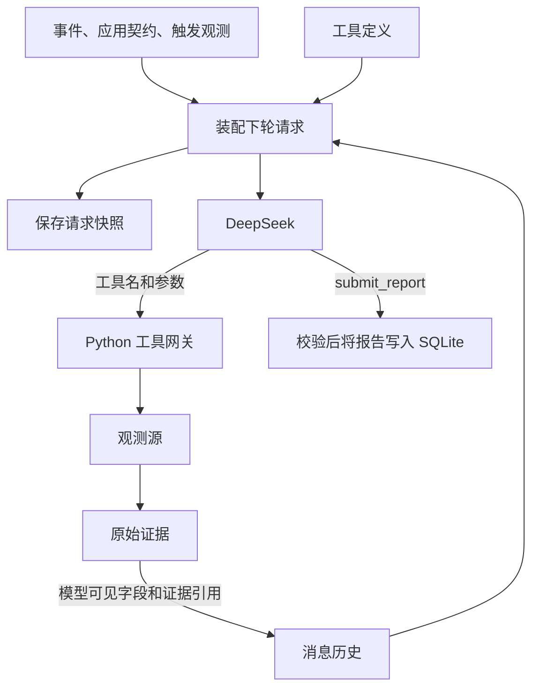

# RobotOps 上下文管理

这里说明现行代码每轮读取、发送和保存的数据。第 1–5 节的实测示例取自 2026-11-24 20:30（北京时间）的 DeepSeek Flash 调查，第 6 节记录 M5 的请求窗口与回归。

## 1. 从故障进入模型

以隔离 UDP 示例为例，初始消息带三组信息。

- **系统指令** 只读调查，区分证据支持与待查情况，通过 `submit_report` 提交。
- **任务数据** 应用 `pipeline`，症状「数据处理链路没有持续输出」，组件 `producer`、`processor`。契约给出最低输入速率 5 Hz、输出静默上限 1 秒和组件依赖。ROS 自动调查还会带上 Topic 静默事实和证据引用。
- **工具定义** 函数名、用途、参数 Schema。默认 v2 短单 Agent 调查直接使用任务里的契约，禁用记忆写入。层级模式或显式扩大请求预算的调查可以使用工作记忆。

## 2. 工具怎么产生新的信息

20:30 实测中，第 1、3 轮的 `query_metrics` 带采样秒数，返回采样窗口、每秒计数变化和当前进程遥测。以下是摘出的关键读数。

| 现场字段 | 第一次 | 第二次 |
|---|---:|---:|
| 发送端累计发送 | 106 | 182 |
| 处理端累计接收 / 完成 | 26 / 25 | 26 / 25 |
| 处理端当前样本耗时 | 4.047 秒 | 7.889 秒 |
| 处理端上次完成样本的耗时 | 0.0081 毫秒 | 0.0081 毫秒 |

同一个开始处理时间始终没变，而在途时长持续上涨。两次采样一起证明处理端有一条已经进入处理的样本没有完成。采样期间接收为零只表示接收计数未变，具体阻塞在哪个函数或通道还需要对应观测。

20:30 实测只调用一次 `search_logs`，返回两条启动日志。此前的 20:05 实测曾按 `processor` 和 `error` 重新查同一批内容，没有得到新线索。当前工具参数中已移除 `refresh`。首次未过滤、未截断且读完的日志形成覆盖边界。后续未指定 `since`，或指定更早起点时，返回原证据 ID、采集时间和复用说明。真正需要看后续日志时，用原结果的 `observed_at` 或更晚时间作 `since`。窗口被截断、日志读取不完整或原证据对当前角色不可见时，仍按请求读取。 [工具实现](../src/robotops/tools.py)

## 3. 每轮实际给模型什么

1. `assemble` 取系统指令、任务、已发生的助手消息和工具回传，以及可用的工作记忆。
2. 默认 `evidence` 保留最新一批完整工具往返。更早的日志可聚合，已归纳或重复的证据可用引用。保护中的关键证据和反证继续保留。
3. 比较候选与原消息数组的 UTF-8 字节数。候选更大就发送完整历史。工具符号和 Schema 独立于消息数组发送。
4. 发送前记录准确快照。模型输出后存公开正文与工具调用。报告工具成功时结束，最后回执只在 Trace，不再请求模型。

20:30 实测四轮都发送了完整历史，第 3、4 轮整理候选更大。第 4 轮收到 11 条消息和 7 个工具定义，消息数组为 11,710 B，供应商实报输入为 5,428 Token。两者计量口径不同。 [装配实现](../src/robotops/agent/context.py)

### 工作记忆

长调查可显式写入事实、证据引用、假设、支持与反对引用、焦点组件和待查事项。程序检查引用的归属与可见范围，新版本继承原有的保护引用。回执仅返回 `status`、`version` 和 `protected_ids`。

20:05 实测模型把「发送端仍在发送」「处理端在途样本持续时间增长」写入记忆，下一轮马上交报告，回执 166 B。现行短调查不再提供这次独立写入，模型即使发出调用也会收到拒绝，不创建记忆版本。 [记忆表实现](../src/robotops/agent/memory.py)

## 4. 数据实际放在哪

| 写入内容 | 位置 | 如何查 |
|---|---|---|
| 原始工具观测 | `runtime.db` 的 `evidence` 保存索引，普通原文放在 `evidence/<证据编号>.json` | `GET /runs/{id}/evidence/{eid}` |
| ROS 触发事实 | `runtime.db` 的 `ros_fact_tasks.fact`，按证据索引读取 | 同一证据接口 |
| 工作记忆 | `memories` 按运行和版本存正文 | `GET /runs/{id}/memory` |
| 各轮真实请求 | `context_snapshots` 存顺序、引用、清单与哈希，正文在 `context_messages`，系统指令与工具定义在 `context_inputs` | `GET /runs/{id}/contexts/{sequence}` |
| 模型回复、工具和实报用量 | `traces/<运行编号>.jsonl`，工具参数由同轮模型响应追溯 | `GET /runs/{id}/trace`、`GET /runs/{id}/usage` |
| 最终报告 | `runs.report` | `GET /runs/{id}` |

快照查询把引用拼回原消息顺序，通过 SHA-256 检查。旧快照可以照原格式读取。本次实测的本地数据库是 `data/real-context-short-20261124-203009-520264/data/runtime.db`。同目录的 `traces/` 可查供应商用量和各轮工具往返，运行产物保存在本机。

## 5. 当前实测和窗口边界

手动调查默认 8 次请求，ROS 自动调查默认 6 次。层级调查的主、子分支共享总额度，主 Agent 保留一轮交报告。连续三批工具未提供新线索会提前收尾。进展按观测内容判断。日志窗口缩小、原文回读、子分支换证据编号或采样时间变化均可识别为重复。在途时长、计数或实例实际变化仍可提供新线索。 [预算及无进展规则](../src/robotops/agent/graph.py) · [观测签名](../src/robotops/agent/recovery.py)

`trace` 的 `model_budget` 事件记录每次额度申请是否获准、总额度、已占用和剩余额度，以及收尾原因。请求快照清单保存同一轮的额度与连续无进展批数。`/usage` 的 `model_budget` 汇总这些记录，供应商实报用量仍在原有字段。额度在组装请求前占用，因此即使快照写入失败，也可区分已占额度和实际模型回包。 [用量汇总](../src/robotops/agent/usage.py)

ROS 1 自动调查的新实测从停机期间落盘的 Topic 事实开始，输入 7,405 Token、输出 2,177 Token，三轮交付引用原始观测的 `needs_human` 报告。 [回放触发的自动实测](RobotOps_当前版本汇报.md#040-自动-topic-实测)

同期独立 UDP 取证实测中第 4 轮交报告，状态为 `proposed`，五项评估通过。报告定位到已进入处理流程的一条样本持续未完成，建议人工检查线程栈和通道。

| 指标 | 20:05 对照 | 20:30 UDP 实测 |
|---|---:|---:|
| 模型请求 | 6 | 4 |
| 实际日志读取 | 3 | 1 |
| 指标采样 | 2 | 2 |
| 工作记忆写入 | 1 | 0 |
| 输入 Token | 33,500 | 16,167 |
| 总耗时 | 30.18 秒 | 16.62 秒 |

本次输入 Token 较上一轮少 51.7%。两次为同场景独立实测，工具选择和采样窗口有变化。按 [评测命令](../README.md#测试与实验) 可重新运行。

## 6. M5 请求前的窗口裁剪

每轮估算消息正文、原生工具参数、当轮工具 Schema 和协议开销。官方 DeepSeek Flash 使用历史实报校准。在 RobotOps 的文本和工具输入中，约每两个 ASCII 字符估为 1 Token，其他字符按每字符 1 Token，再加协议余量。校准样本共 25 次请求，估算在实报的 1.21–1.76 倍之间。未知端点继续用保守的 UTF-8 字节代理，快照注明计量方式。实际用量以模型的 `prompt_tokens` 为准。 [DeepSeek 的 Token 计量](https://api-docs.deepseek.com/quick_start/token_usage/)

估算超过 **131,072 输入 Token** 时启动裁剪，可用 `ROBOTOPS_CONTEXT_COMPACT_AFTER_TOKENS` 调整。官方 DeepSeek Flash 总窗口为 1,048,576 Token，RobotOps 使用非思考模式，发送请求时默认省略 `max_tokens`。可用输入上限是总窗口减去服务端生成额度或显式设置的 `ROBOTOPS_MODEL_OUTPUT_TOKENS`。自定义端点可用 `ROBOTOPS_CONTEXT_WINDOW_TOKENS` 声明总窗口。总窗口未知时，输入阈值也作为本地上限。 [DeepSeek 模型容量](https://api-docs.deepseek.com/api/list-models/) · [生成参数](https://api-docs.deepseek.com/api/create-chat-completion/)

| 顺序 | 请求内容如何变化 |
|---|---|
| P4 重复记录 | 将过去重复的工具回复和复用缓存的日志回执缩为引用。 |
| P3 助手草稿 | 去掉可见的助手叙述和已归档的助手笔记。原生工具参数和回复保持配对。 |
| P2 工具结果 | 先把旧工具结果归档，再视空间把最近的普通工具结果缩为引用和诊断字段。保留速率、输出时间、在途耗时、进程状态和实例 ID。活跃假设保护的旧证据在 4 KiB 正文预算内可保留；超过模型输入上限时，才进一步缩小受保护正文和最近的回读结果。 |
| P0/P1 系统指令、任务、工具 | 系统指令和任务完整保留。到收尾阶段时只开放报告工具，该工具的 Schema 保持完整。 |

每一级都以同一估算器复核。优先为相当于上一批工具返回的输入留空间，具体释放量由实际载荷决定。工作记忆的模型视图最多约 8 KiB，保留它能装下的焦点、活跃假设、事实和待查问题。保留的假设同时保留支持与反对引用，裁剪量记在 `omitted`，SQLite 中的版本和原始证据仍可回查。 [上下文装配与记忆预算](../src/robotops/agent/context.py)

预检仍超限时，缩小为只提交报告；仍放不下时，用已验证证据生成本地 `needs_human` 报告。收到供应商明确的窗口超限错误后，最多追加一次更小的报告请求，并扣除一次模型调用额度。分支无法收尾时返回 `blocked`。 [调查收尾](../src/robotops/agent/graph.py)

`GET /runs/{id}/contexts/{sequence}` 的 `manifest.context_window` 记录本轮阈值、输入上限、裁剪前后估算和实际裁剪步骤。`GET /runs/{id}/usage` 的 `context_window` 关联相同请求的实报输入、缓存、估算误差和超限重试次数。旧请求已保存的字节估算仍可在原快照中回查。 [用量汇总](../src/robotops/agent/usage.py)

### 模型回读原始证据

`search_logs(limit=200)` 最多保存 200 条匹配日志。大型结果首次只把最新一页发给模型，最多 20 条，且受 16 KiB 紧凑数据正文预算限制。`page.offset` 和 `page.total` 表示预览在整份证据中的位置。要查看更早的记录，用同一证据 ID 从 `offset=0` 开始分页。短小结果仍直接返回。

例如 `read_evidence(evidence_id=id, offset=0, limit=20, fields=["component", "telemetry"])` 会回读同一证据，返回日志前一页，顺带保留可用的时间和实例。日志默认最多 20 条，最多可请求 50 条，同时受 16 KiB 紧凑数据正文预算限制。下一页用 `next_offset`。超长行位置记在 `omitted_rows`，可用更窄字段复查结构化记录。非日志证据通常一次给出，较大的观测支持指定顶层字段。

工具回读返回原证据 ID 和原文校验哈希。审计接口 `GET /runs/{id}/evidence/{evidence_id}` 可查看完整原文。连续取到不同日志行会推进调查，重复回读同一批行不会延长调查。进展检查复用本次网关读取的已校验原文，按实际出现在工具回复中的行计算，跳过只有占位的超长行。 子调查仅返回证据引用时，主调查在实际回读后才登记已看过的日志行。 [工具入口](../src/robotops/tools.py)

### 长调查离线回归

固定轨迹的基础装配对照显示，重复日志场景中，滚动摘录与证据感知装配相对完整历史分别减少 52.0% 和 54.9% 的请求字节。短调查中的证据策略保留原视图，字节数持平。参数变体场景中，滚动摘录省去了其中一个关键参数值，证据感知装配通过全部保留检查。具体比例会随输入而变。 [装配对照入口](../README.md#测试与实验)

下表是切换计量前的历史回归，使用旧字节代理。通过 ChatDeepSeek SDK 发送到离线传输替身，测试输入阈值设为 14,952，模型总窗口设为 17,000，显式生成上限设为 2,048。第二次取证得到 110 行日志，令第 3 次请求超限。下表记录的是预检的估算值。

| 请求 | 估算压缩前 | 复核后 | 剩余空间 |
|---|---:|---:|---:|
| 1 | 8,657 | 8,657 | 6,295 |
| 3 | 59,095 | 10,076 | 4,876 |
| 4 | 63,615 | 10,497 | 4,455 |
| 7 | 77,175 | 11,760 | 3,192 |

第 3 次请求缩小后继续发送了 4 次请求，最终报告引用 6 份观测，110 行原始日志按证据 ID 回查。回归还验证了支持与反对证据、追加用户约束和工具调用配对，以及两种窗口不足的收尾。 [M5 回归用例](../tests/test_context_window.py)

### 真实进程与 DeepSeek 压力复测

2026-11-25 用本机 UDP 子进程制造处理停滞，将估算输入阈值降到 12,000。首次调查中，裁剪移除了指标的嵌套速率和进程状态，6 次原文回读也没有把这些值送回模型，最后用尽 8 次请求，由本地生成 `needs_human` 报告。

修复后用同一场景和阈值复测。裁剪后的指标仍包含生产端约 19.5–20 Hz、处理完成速率 0 Hz，以及同一条在途消息从约 3.0 秒增加到 22.1 秒的记录。两次原文回读都完整发送，第 8 次请求提交 `proposed` 报告，定位到处理端有在途消息长期未完成。报告的 9 条证据引用均可回查，基准 5 项检查通过。本轮验证的是裁剪后能否完成诊断，模型实报输入 45,781 Token、输出 2,254 Token。 [回归用例](../tests/test_context_window.py)

### 默认阈值长日志校准

2026-11-25 13:08（北京时间），用同一个本机 UDP 处理停滞场景，在两个子进程运行期间采样并写入 220 条结构化观测日志。最近 200 条日志合计约 167 KB。通过真实 DeepSeek Flash 在当时的默认阈值 131,072 下调查，预检采用旧字节代理。请求实报列为模型收到的裁剪后输入。

| 请求 | 输入估算前 → 后 | 相对触发线余量前 → 后 | 实报输入 / 输出 | 缓存命中 / 未命中 |
|---|---:|---:|---:|---:|
| 1 | 9,067 → 9,067 | 122,005 → 122,005 | 2,351 / 116 | 1,920 / 431 |
| 2 | 208,628 → 13,449 | −77,556 → 117,623 | 3,886 / 62 | 2,304 / 1,582 |
| 3 | 404,416 → 209,321 | −273,344 → −78,249 | 78,732 / 123 | 2,304 / 76,428 |
| 4 | 408,336 → 17,453 | −277,264 → 113,619 | 5,291 / 56 | 3,712 / 1,579 |
| 5 | 603,884 → 17,691 | −472,812 → 113,381 | 5,429 / 91 | 3,712 / 1,717 |
| 6 | 660,183 → 215,707 | −529,111 → −84,635 | 81,054 / 2,699 | 4,864 / 76,190 |

第 2 轮裁剪后仍带生产速率、处理完成速率和进程状态。第 3、6 轮按需完整回读 200 行证据，两轮合计 159,786 输入 Token，占本次 176,743 输入 Token 的约 90%。两次请求估算超过项目压缩触发线，仍能装进模型实际窗口。最终模型报告引用 6 份可回查证据，定位到处理端单个样本长期未完成，并把缺少调用栈的阻塞机制留待人工判断。报告状态为 `needs_human`，场景基准 **4/5**，未通过的一项是期望 `proposed`。本地摘要、逐轮用量、证据和数据库位于 `data/m5-default-pressure-20261125-130822-731381/`。

### 分页优化后的同输入回放

用上次真实调查的六份已保存请求做离线对照，只替换第 3、6 轮的整份日志回读。每份原证据有 200 行，分页后实际返回 19 行，保留相同的证据 ID 和 SHA-256。原报告的六份证据仍通过原文校验。

| 请求 | 上次实报输入 Token | 新估算器估算原请求 | 换成一页后估算 |
|---|---:|---:|---:|
| 3 | 78,732 | 95,395 | 14,913 |
| 6 | 81,054 | 98,209 | 17,727 |
| 六轮合计 | 176,743 | 219,183 | 58,219 |

同一轨迹估算输入下降约 73%。两轮替换各将日志回读工具消息正文从约 178 KB 降到约 17 KB。历史实报来自原请求，分页列是离线估算。回放详情位于 `data/m5-context-replay/summary.json`。

### 分页优化后的 DeepSeek 真机实测

2026-11-25 13:40（北京时间），启动隔离 UDP 生产和处理子进程，制造处理中的样本停滞。用 DeepSeek Flash 实际发出 4 次请求，要求回读同一份 200 行日志的早期和晚期记录。模型选择了偏移 0 和 180 的两页，分别读到 6 行和 20 行。逐行对照证据原文，字段值和 SHA-256 一致，原文仍有 200 行。模型报告为 `proposed`，场景评估 5/5，4 条报告证据均通过原文校验。报告定位了处理端停滞，具体阻塞点仍需要堆栈。报告摘要误写成「首次处理样本后卡死」，引用的计数显示当时已有 4 个样本完成。

| 请求 | 估算输入 Token | 实报输入 / 输出 Token | 缓存命中 / 未命中 Token |
|---|---:|---:|---:|
| 1 | 4,495 | 2,613 / 86 | 0 / 2,613 |
| 2 | 94,246 | 78,578 / 352 | 2,688 / 75,890 |
| 3 | 106,734 | 89,381 / 44 | 78,848 / 10,533 |
| 4 | 107,019 | 89,618 / 1,710 | 89,344 / 274 |

新版实报输入合计 **260,190 Token**，输出 2,192 Token，缓存命中 170,880 Token。相比先前同场景的独立调查，总输入增加 47.2%，缓存未命中的输入从 157,927 降到 89,310 Token。首次 `search_logs` 返回的 200 行原样进入第 2、3、4 轮，每次约 178 KB。各轮估算均低于 131,072，窗口裁剪没有触发。两次实测的工具轨迹不同，这组数字反映端到端行为，分页本身的影响见上面的同输入回放。逐轮数据位于 `data/m5-bounded-evidence-20261125-134035-322975/summary.json`。

### 首次日志预览修复后的 DeepSeek 复跑

2026-11-25 13:45（北京时间），在相同的隔离 UDP 停滞场景重新发起调查。首次查询只送出 19 行预览，消息正文从上次的 178,187 B 降到 17,447 B。模型随后各回读 20 行早段和晚段日志。预览与两页都逐行对照了同一份 200 行原证据，5 条报告引用也通过校验。

| DeepSeek 实报 | 修复前 | 首次预览修复后 |
|---|---:|---:|
| 调查请求数 | 4 | 5 |
| 输入 Token | 260,190 | 85,134 |
| 输出 Token | 2,192 | 2,467 |
| 缓存命中 Token | 170,880 | 58,496 |
| 缓存未命中 Token | 89,310 | 26,638 |

完整调查的输入减少 **67.3%**，未命中输入减少 **70.2%**。任何一轮都未达到 131,072 Token 的裁剪阈值，改善来自首次预览。模型报告为 `proposed`，场景评估 5/5，确认生产端约 19.5–20 Hz、处理端完成速率 0 Hz，在途样本耗时从约 0.76 秒增加到 15.06 秒。

首次预览复跑的报告仍误写了「首个输入即卡住」。现在提交时会针对这类说法核对目标组件引用的累计完成数和时间戳。把原报告交给新校验会被拒绝，再用当时的上下文追加一次真实 DeepSeek 纠错请求，报告改为已完成 4 个样本、当前在途样本持续未完成，具体阻塞机制待查。纠错请求额外输入 28,078 Token，两次阶段合计 **113,212 输入 Token**，较修复前少 **56.5%**。这次纠错使用同一现场的请求快照。详细记录位于 `data/m5-log-preview-20261125-134535-408562/`。

### 重叠日志与证据归属回归

同一模型请求里，后来的原生工具回复只省略已经在更早回复中出现的相同证据行和字段。保留下来的行用 `page.row_indices` 标明在原证据中的位置，`page.next_offset` 继续沿用原始分页游标。新增字段仍会发送。只有实时进程检查和指标采样可以更新当前实例，旧控制台日志保留为旧现场证据。报告的首个样本断言按它提到的组件、可识别的实例和引用证据校验。

用上一次 UDP 实测保存的五份请求做离线对照，晚段页的 20 条里有 19 条已出现在首次预览。第 4、5 轮分别只保留索引 180 的新行。五轮输入估算从 108,484 降到 93,150 Token，减少 14.1%。对照数据位于 `data/m5-log-preview-20261125-134535-408562/overlap-replay.json`。
