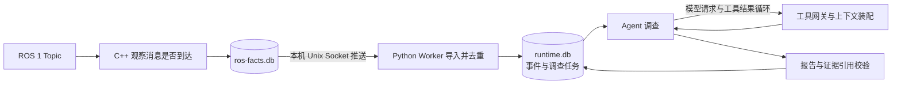

# RobotOps 项目阶段汇报

**状态日期** 2026 年 11 月 24 日

RobotOps 持续观测机器人应用，发现异常后留下现场记录，并在适用的场景中自动发起调查。在本机 ROS 1 Noetic 上，已跑通完整链路：发布节点仍在线，Topic 停发，系统自动建事件、派任务、生成一份可以回查原始观测的诊断报告。当前采集链路使用本机 Unix Socket，由 C++ 在写入现场事实后主动推送给 Python。

## 0.4.0 本次交付

| 范围 | 交付内容 |
|---|---|
| 恢复 | ROS 1 保留显式允许的一次 launch 重启，记录新实例的启动验收。systemd 负责监测和事件记录，旧动作可按原事件回查。 |
| ROS 事实 | C++ 写入事实后推送。Worker 启动时只读补录漏接记录，派发已入库的待调查任务；实时和回放路径用同一来源序号去重。 |
| 调查收尾 | 手动调查默认 8 次请求，ROS 自动调查默认 6 次；主子分支共用一次运行的预算。连续三批无新线索时提前交报告。 |
| 回归 | 重新构建 Noetic 采集器，102 项测试全部通过。已构建 0.4.0 wheel。 |

## 0.4.0 自动 Topic 实测

2026-11-24 21:02（北京时间），隔离 Noetic 发布节点在线，暂停发布 `/robotops_040/output`。Worker 此时未启动，C++ 保存事实且推送失败。Worker 启动后补录 1 条观测、派发 1 次调查，DeepSeek Flash 交付 `needs_human` 报告。使用 `GET /incidents/{id}` 的 `automatic_run_id`、运行报告和证据接口可以查回同一条链路。

| 字段 | 实际记录 |
|---|---|
| 模型 | DeepSeek Flash |
| 用量 | 3 次请求，输入 7,405 Token，其中命中缓存 4,864；输出 2,177 Token |
| 触发事实 | `topic_silent`，序号 1，静默 619 ms，检测阈值 600 ms |
| 证据编号 | `ev-4a21343e21d04a3ab1a85166c708773e` |
| 运行编号 | `run-5bf85d6456d94482ba055fcf018533ad` |
| 结果 | `COMPLETED` / `needs_human`，建议补采后续输出速率、输入流量和发布节点状态 |

测试的检测阈值为 600 ms，应用契约允许静默 1 秒。报告正确区分了这两个阈值，并要求补证才能确认业务故障。一次未开放的记忆写入被后端拒绝，最终报告仍引用了原始 Topic 证据。实测摘要、SQLite 和 Trace 留在本机 `data/ros1-deepseek-040-20261124-210209-017553/`。

## 1. 一条故障数据怎么走

下面用一次真实 Noetic 联调的数据说明字段和编号。应用是 `camera`，观测对象是 `/smoke/output`，测试设置的静默阈值是 500 ms。采集器记录到 519 ms 静默，调查自动启动。实际 ROS 节点负责产生观测，测试用固定模型响应验证后半段。 [ROS 1 联调测试](../tests/test_ros_facts.py)



### ① C++ 看到什么，实际落了哪一行

采集器收到第一条消息后开始监测。静默达到阈值时，`ros-facts.db` 的 `topic_silences` 表写入这一行。两个时间戳是 Unix 毫秒，静默时长用单调时钟计算。

```json
{
  "sequence": 1,
  "observed_at_ms": 1795509114579,
  "last_message_at_ms": 1795509114059,
  "silent_ms": 519,
  "threshold_ms": 500
}
```

同一个库的 `source` 表保存来源 ID、应用名 `camera`、Topic `/smoke/output`。C++ 写完事实后把这些字段与本次观测拼成一条 Socket 消息。下面就是 Python 收到后实际保存到 `ros_fact_tasks.fact` 的 JSON。

```json
{
  "sequence": 1,
  "kind": "topic_silent",
  "observed_at_ms": 1795509114579,
  "last_message_at_ms": 1795509114059,
  "silent_ms": 519,
  "threshold_ms": 500,
  "source_id": "11b1b264fdeb429b64d50a3b4bca149e",
  "app_id": "camera",
  "topic": "/smoke/output"
}
```

### ② Python 怎么把事实变成一次调查

Worker 用 `(source_id, sequence)` 去重，在一个事务里把事件和调查任务写进 `runtime.db`。这条事件的 `symptom` 是 `ROS 1 Topic /smoke/output had no messages for 519 ms`。三个 ID 串起从异常到原文的查询路径。

```json
{
  "incident_id": "inc-db287c81de734ce38fea1c259038242a",
  "run_id": "run-0eceb08403df41a2b271c7ebc6af0b37",
  "evidence_id": "ev-48b4d00e287e48569ea774ffa50948bd"
}
```

调查开始时，SQLite 的 `evidence` 表登记 `ev-48b4d00e287e48569ea774ffa50948bd`，保存事件、运行归属、来源 `ros1_topic_observation` 和原文 SHA-256。按证据 ID 回查时从任务表读原文，返回的数据包含采集时间 `2026-11-24T08:31:54.579000+00:00` 和完整观测。

### ③ 给模型看了什么，最后存下什么

第 1 轮的 `context_snapshots` 保存了真实任务消息。消息里包含事件、应用契约和带证据 ID 的完整触发事实。下面摘录其中三个字段。快照还另存工具 Schema 的共享引用、版本为 0 的空工作记忆和装配清单。本轮 `request_bytes` 是 3,037，只统计消息 JSON 的字节数。

```json
{
  "incident": {
    "ros_fact": {
      "topic": "/smoke/output",
      "silent_ms": 519,
      "evidence_id": "ev-48b4d00e287e48569ea774ffa50948bd"
    }
  }
}
```

固定模型响应返回以下 JSON，Python 校验后写入 `runs.report`。

```json
{
  "status": "needs_human",
  "summary": "Topic stopped delivering messages",
  "hypotheses": [
    {
      "cause": "Exact cause unknown",
      "assessment": "unverified",
      "evidence_ids": [
        "ev-48b4d00e287e48569ea774ffa50948bd"
      ]
    }
  ],
  "recommended_action": {
    "kind": "manual_review",
    "target": null,
    "reason": "Check the publisher",
    "evidence_ids": []
  },
  "unresolved_questions": []
}
```

运行状态为 `COMPLETED`，事件状态为 `NEEDS_HUMAN`。调查已经交付，仍需人工检查发布端。报告里的证据 ID 可以回查 519 ms 静默的原文。 [C++ 事实接口](../cpp/ros1_facts/main.cpp) · [Python Worker](../src/robotops/ros_facts.py) · [调查入口与报告校验](../src/robotops/agent/workflow.py)

## 2. Agent 的四部分怎样配合

| 部分 | 在 RobotOps 里做什么 |
|---|---|
| **感知** | C++ 感知 Noetic Topic 的消息到达情况。Python 也可以通过受管进程入口记录退出和控制台输出，用 systemd 监测器读取已登记服务状态，或使用场景适配器获取实时进程、指标、日志与配置。 |
| **大模型** | DeepSeek 接收诊断任务、证据和工具定义，选下一步查什么、提出故障假设、组织诊断报告。LangGraph 组织模型和工具之间的循环，工具定义、业务状态及校验由 RobotOps 实现。 |
| **记忆** | 长调查和层级调查可以用工作记忆记录这一次查到哪、有哪些假设、哪些证据支持或反对、下一步还要查什么。长期案例库保存经外部验证的历史案例，按应用和版本经 SQLite FTS5 检索，供当前调查参考。 |
| **工具** | 模型发出工具名和参数，Python 通过注册表和网关校验后实际执行。机器人端的原始观测、案例和证据回取都有固定入口。写入工作记忆和提交报告只改变调查记录。 |

### 一次工具调用怎么走

1. **发给模型。** 程序装配系统指令、事件、应用契约、适用的历史和记忆，并把可用工具的名称、用途和 JSON Schema 与消息一起发送。请求前先保存本轮快照。
2. **模型选工具。** 例如，如果模型要核对触发事实，就返回 `read_evidence` 和证据 ID。每次工具请求都带调用 ID。
3. **程序实际执行。** 网关核对工具白名单、参数类型、当前应用和证据范围。回取时按运行 ID 找原文并核对 SHA-256。日志查询有时间、关键词和条数限制，数据来源由程序确定。
4. **结果回给模型。** 新观测先保存原始响应并分配证据 ID，部分进程和指标结果可用精简视图回传。程序按原调用 ID 送回结果，模型再决定继续取证、更新记忆，或用 `submit_report` 结束。

| 工具 | 实际作用 |
|---|---|
| `get_application_contract` | 查看本次应用的组件、依赖和健康标准。契约也会随初始任务提供。 |
| `inspect_process`、`query_metrics` | 查看适配器提供的真实进程、运行实例、输入输出速率和新鲜度等。 |
| `search_logs`、`get_recent_config_changes` | 查询配置记录和受管日志。由启动入口触发的退出事件也可查询该次运行的控制台日志片段。 |
| `read_evidence`、`retrieve_cases` | 回取本次调查的证据原文，或找当前应用与版本可用的历史案例。 |
| `update_working_memory`、`submit_report` | 在可用时保存带证据引用的工作记忆，或提交供后端校验的诊断报告。默认短调查直接交报告。 |

**ROS 1 自动链路的实际取证范围。** 默认跑单 Agent，最多请求模型六次。触发的 Topic 事实已随任务送入，可回取该原文、查应用契约和适用案例。该 Worker 暂未接实时观测适配器，工具列表只公开可读的证据和案例入口以及报告提交。接了适配器的 Pipeline 示例可用这些现场工具。手动调查还支持主 Agent 用 `dispatch_investigation` 分派应用和系统检查，由子 Agent 用 `submit_finding` 提交发现并按角色共享证据。 [工具注册表和校验](../src/robotops/tools.py) · [模型与工具循环](../src/robotops/agent/graph.py) · [角色分工](../src/robotops/agent/supervision.py)

## 3. 上下文窗口、压缩和回查

### 工具原文、工作记忆、模型请求分别保存什么

这是一份模拟导航应用的多轮测试。`navigation` 是应用名，`planner` 是规划组件的代号，可以理解为「根据输入计算路线」这一侧。`sensor` 是给规划组件提供数据的上游组件代号。这两个名字和依赖关系来自测试配置。这个测试记录的是工具与记忆的数据流，工具选择由固定模型响应驱动。

**第 1 轮，模型收到故障并请求应用配置。** RobotOps 发给模型的输入包含系统指令、故障文字「输入断流」、应用契约和允许调用的工具定义。固定响应要求再次核对契约，输出工具调用 `get_application_contract({})`。

**第 1 轮工具执行，Python 返回配置和证据 ID。** 网关从 SQLite 读取 `navigation` 的契约，写入 `evidence/ev-17ea0c4e78a7470fb47f3efd5f5c4e49.json`，把结果和证据 ID 交给下一轮。下面是证据文件里的 `data`。`5.0 Hz` 是配置规定的最低输入速率，现场实际速率需要另外取样。

```json
{
  "app_id": "navigation",
  "version": "2",
  "description": "",
  "components": [
    "planner",
    "sensor"
  ],
  "dependencies": {
    "planner": [
      "sensor"
    ]
  },
  "health": {
    "min_input_hz": 5.0,
    "max_output_silence_seconds": 1.0
  }
}
```

**第 2 轮，模型收到配置和证据 ID，输出一条调查笔记。** 模型返回工具调用 `update_working_memory`，调用 ID 是 `call-2`。参数把阶段设为 `investigation`，写下「契约需要 sensor 输入」，并将第 1 轮拿到的证据 ID 标为关键。Python 校验后把完整笔记写到 `runtime.db` 的 `memories.body`，回传 `status: "ok"` 和 `version: 1`，这条回执会出现在第 3 轮输入里。实存的记忆如下。

```json
{
  "version": 1,
  "memory": {
    "phase": "investigation",
    "focus_components": [],
    "facts": [
      {
        "statement": "契约需要 sensor 输入",
        "evidence_ids": [
          "ev-17ea0c4e78a7470fb47f3efd5f5c4e49"
        ]
      }
    ],
    "hypotheses": [],
    "critical_ids": [
      "ev-17ea0c4e78a7470fb47f3efd5f5c4e49"
    ],
    "pending_questions": []
  },
  "protected_ids": [
    "ev-17ea0c4e78a7470fb47f3efd5f5c4e49"
  ]
}
```

**第 7 轮，Python 整理旧数据再发给模型。** 输入包含最初的任务与契约、版本 1 的调查笔记、第一条完整契约证据、部分重复查询的证据引用，以及最近一批完整的工具请求与回复。固定响应这一轮再次请求契约。以下是 Python 存入 `context_snapshots.body` 的快照清单中两条记录的摘录，显示同一轮里一条保留了工具回复，一条只发送了引用。

```json
[
  {
    "tool": "get_application_contract",
    "evidence_id": "ev-17ea0c4e78a7470fb47f3efd5f5c4e49",
    "view": "protected_raw"
  },
  {
    "tool": "get_application_contract",
    "evidence_id": "ev-7c54ddc7fdd64448b80baefc0aa57705",
    "view": "duplicate_reference",
    "raw_uri": "evidence:ev-7c54ddc7fdd64448b80baefc0aa57705"
  }
]
```

**第 17 轮，模型输出报告。** 报告状态是 `needs_human`，摘要是「仅做协议测试」，人工检查理由是「缺少当前实测」。Python 把它保存到 `runs.report`。前面查到的契约可以指出该去哪里取证，最终报告仍需要说明现场缺了哪些数据。

第 7 轮从 6,528 字节的完整消息整理到 6,284 字节。第 3 轮候选视图更长，选择了 `full_fallback`，送出 3,936 字节的完整历史。字节比较只量消息。系统指令和工具定义在请求快照间共享，每条消息正文存一次，供应商实报的输入、输出及缓存 Token 另记在轨迹。 [多轮测试](../tests/test_g1.py#L482) · [上下文装配与快照](../src/robotops/agent/context.py)

#### 一条反证在多轮调查里怎么保留

另一个单元测试用值为 0 和 20 的两条模拟指标验证反证保护。输入是模型提交的下列调查笔记，它把两条记录关联到「无输入」这一假设。Python 保存笔记时把这两个引用都加入保护集合。

```json
{
  "claim": "无输入",
  "assessment": "unverified",
  "support_ids": [
    "ev-3075ca3082494e4e811f9987efd0e187"
  ],
  "contradict_ids": [
    "ev-e735980c490a40159b00417ee7362234"
  ]
}
```

版本 2 的输入把阶段更新成 `reporting`，提交的假设列表为空。输出的新记忆版本里，两条证据 ID 仍都在 `protected_ids`，完整的版本 1 也还在库里。较早的工具回复进入历史整理时，这两个 ID 会按受保护证据处理，原始数据也可按 ID 回查。 [反证保护测试](../tests/test_g1.py) · [工作记忆写入](../src/robotops/agent/memory.py)

### 模型窗口怎么管，M5 待评测的设计

**128K 可以是某个模型的一轮总窗口。** 实际上限由选用的模型和服务端决定。系统指令、工具 Schema、任务、记忆、历史和工具返回都要计入输入预算，还要留出生成空间。目前代码已能做上面的证据整理，请求前 Token 估算、输入硬限额和按窗口压力触发压缩待实现。

- **Claude Code** 在接近窗口上限时摘要历史，支持指定摘要应保留的重点。如果一次工具输出导致压缩后窗口反复填满，会停止自动压缩循环。 [Claude Code 的上下文机制](https://code.claude.com/docs/en/how-claude-code-works#when-context-fills-up) · [反复压缩的处理](https://code.claude.com/docs/en/troubleshooting#auto-compaction-stops-with-a-thrashing-error)
- **Codex** 分别管理窗口硬上限和自动压缩触发阈值。超过阈值后，可以通过 `/responses/compact` 得到更短的上下文供后续请求使用。 [公开窗口计量实现](https://github.com/openai/codex/blob/main/codex-rs/core/src/session/context_window.rs) · [Codex Agent Loop](https://openai.com/index/unrolling-the-codex-agent-loop/)
- **DeepSeek Harness** 用模型窗口、生成预留和额外余量计算触发线。触发后可以先裁减大工具结果，空间够就跳过模型摘要；需要摘要时，保留近期成对的工具请求和回复，摘要较早的交互。其近期保留比例用于限定保留多少原始历史，整个请求还包含系统指令、工具定义和摘要。 [DeepSeek Harness 压缩设计](https://github.com/deepseek-ai/deepseek-harness/blob/master/packages/compaction/compaction-basic/README.md#tuning-when-condensation-starts)

RobotOps 的待验证方案是先计量、再整理、最后按需摘要。

1. **请求前算空间。** 按当前模型和服务端的限制算输入上限，给生成留预算。触发线还要能容纳一批有上限的工具输出和估算误差。日志和原文查询优先限制范围、条数和返回大小。
2. **有窗口压力就先做低成本整理。** 用重复聚合、原文引用和已有工作记忆，再估算一次。需要摘要时才处理较早且已完成的交互。保留任务、关键数值、支持证据和反证的引用、最近一批成对的工具请求与回复，原文件仍可回查。
3. **复核下一次触发前还能查几轮。** 用同一计量方式重算压缩后的占用。`触发线 − 压缩后占用` 才是再次触发前能新增的数据量。按回放里实际的工具结果增长量检验这段空间，至少能接住下一批受控结果及估算余量。若一条超大结果让空间很快见底，缩小查询或回取范围。遇到窗口超限，输入确实变小后才有限重试，空间仍不足时带着已有证据和待查项收尾。

触发阈值、最近历史保留量和摘要上限由回放调参。短调查应直接完成，多轮调查要记录压缩次数和两次压缩之间做了几轮有效取证。另用单条大输出和大量独特证据测试预算与收尾。每次都记录压缩前后 Token、腾出的空间、耗时和关键证据保留情况。 [上下文管理](RobotOps_上下文管理.md#5-当前实测和窗口边界)

## 4. 两个数据库在哪里，各存了什么

本机两份常驻库已在 `data` 初始化，SQLite 完整性检查都通过。运行与联调数据分目录保存。

| 谁创建 | 文件位置 | 位置由什么决定 |
|---|---|---|
| Python API、Worker 或其他运行入口初始化存储 | `data/runtime.db` | 默认数据目录是启动目录下的 `data/`，可经配置文件或 `ROBOTOPS_DATA_DIR` 指定。 |
| C++ ROS 1 采集器启动 | `data/ros-facts.db` | 最后一个启动参数明确指定文件路径。README 示例传入 `data/ros-facts.db`。 |

前文的 Unix Socket 联调数据来自 pytest 的临时目录。运行 Noetic 联调用例可以重新生成两库、日志与报告。

- **`ros-facts.db`** 在测试目录根部。实际查到 `camera` 的 `/smoke/output`，1 条静默记录，序号 1，阈值 500 ms，测得 519 ms。
- **`platform/runtime.db`** 在同一测试目录的 `platform/` 下。实际查到 1 个事件、1 个自动任务、1 次完成的调查、1 份报告、1 条证据索引、1 个请求快照。本次固定模型响应直接返回报告 JSON，工具调用数和工作记忆版本数均为 0。

多轮记忆和反证的数据库分别在同一批测试目录 `pytest-21` 下的 `test_workflow_uses_memory_and_0/runtime.db` 和 `test_memory_scope_and_monotoni0/runtime.db`，各自的原始证据在同级 `evidence/` 目录。

### 当前版本的去重

ROS 触发事实通过证据 ID 回读 `ros_fact_tasks.fact`，新的触发证据会在 `evidence` 表登记归属和哈希。其他诊断工具仍有独立证据文件。系统提示词与工具定义放在 `context_inputs`，消息正文放在 `context_messages`，`context_snapshots` 保存顺序引用、装配清单与哈希。API 查询会还原实际发送的内容。Trace 通过对应的快照和证据查回原对话和观测。

### 表里有哪些数据

| 位置 | 表 | 保存的内容 |
|---|---|---|
| **C++ `ros-facts.db`** | `source`、`topic_silences` | 来源 ID、应用、Topic；每条静默的序号、发现时间、末条消息到达时间、静默毫秒数和阈值。当前采集器仅跟踪到达时间。 |
| **Python `runtime.db`** | `applications`、`incidents`、`ros_fact_tasks`、`runs` | 应用契约；异常症状、来源和状态；触发事实 JSON、副本对应的来源和序号、已关联的调查；每次调查的模型、状态、起止时间、报告正文或错误。 |
| **Python `runtime.db`** | `evidence`、`memories`、`context_snapshots`、`context_inputs`、`context_messages` | 证据的运行和事件归属、工具来源、时间、SHA-256；工作记忆每个版本的正文；每轮请求的消息与工作记忆引用、装配清单、工具与系统指令引用、序号和哈希，可重组为完整 JSON。 |
| **Python `runtime.db`** | `cases`、`cases_fts` | 历史案例正文、应用与版本，以及全文检索索引。 |
| **Python `runtime.db`** | `managed_services`、`service_exits`、`recovery_actions`、`executions`、`execution_exits`、`launch_restarts` | 已登记的 systemd 单元和观测、服务退出读数、旧版动作及依据、程序启动和结束记录、故障出口日志位置、重启前后执行关联与验收状态。 |

Python 数据目录还保存三个目录下的文件。数据库用 ID 串起这些记录，查看一份完整报告时可以顺着 ID 找到原文。

| 文件 | 内容 |
|---|---|
| `evidence/<证据 ID>.json` | 普通工具的原始观测或响应，证据表中的 SHA-256 用于核对内容。 |
| `traces/<运行 ID>.jsonl` | 每轮模型请求的快照编号、校验后的回复、工具参数和结果索引、错误及供应商返回的 Token 用量。 |
| `executions/<启动记录 ID>.log` | 由 Python 启动入口运行的普通命令或 ROS 1 launch 的标准输出和标准错误。 |

API 侧从 `GET /incidents/{id}` 可看到触发事实和自动调查的运行 ID。用 `GET /runs/{run_id}` 查报告，用 `/evidence/{evidence_id}`、`/contexts/{sequence}`、`/memory`、`/trace` 或 `/usage` 接在运行 URL 后查看原文、请求输入、记忆、轨迹和用量。 [启动与查询方式](../README.md#用-ros-1-topic-触发自动调查) · [SQLite 表与文件读写](../src/robotops/storage.py)

## 5. ROS 1 故障怎么恢复

RobotOps 根据观测类型分流。下面用相机举例。

- **单个普通节点退出。** 已配置 `respawn="true"` 的节点由原 `roslaunch` 拉起。RobotOps 保留它的退出码和故障前的控制台输出。
- **整条 launch 异常结束。** 用户运行 `robotops run --restart-on-exit camera -- roslaunch camera_driver camera.launch` 时，Runner 获准按原参数重启一次。触发条件是 launch 非零退出，或本机必需节点非零退出并导致这次 launch 结束。启动范围由这个 launch 文件定义。
- **进程还在，Topic 停发。** C++ 把观测推给 Python，Worker 自动建任务并让 Agent 调查。有了确切故障依据以后，再决定处置目标。业务验收要看到原 Topic 在观察期内持续有新消息。

一次重启的记录可以从 `GET /incidents/{id}` 直接读到。`execution_exit.execution_id` 指向故障前的旧启动和日志，`launch_restart.execution_id` 指向新的启动。Runner 等 ROS 报告启动完成，再观察 5 秒。通过记为 `STABLE`，提前退出记为 `FAILED`，验收中操作员停止记为 `INTERRUPTED`。`STABLE` 只说明新 launch 通过了进程级验收，原故障继续保留供调查。

Noetic 联调中，测试节点第一次退出码为 17，第二次启动达到进程稳定期。事件详情中的关联字段摘录如下。另一个场景模拟两次都失败，最终只留下两次执行。

```json
{
  "incident_id": "inc-eed85fe7a554473aaef7252be992e79e",
  "execution_exit": {
    "execution_id": "exec-58b1d6f3d0384d94ba0443cd6ed65ba8",
    "exit_code": 17
  },
  "launch_restart": {
    "execution_id": "exec-ef668d37097644e58f69bdd0c0221eca",
    "state": "STABLE",
    "checked_at": "2026-11-24T08:32:03.622357+00:00"
  }
}
```

systemd 适合开机启动 RobotOps 自己、长期运行的非 ROS 服务，或需要无人值守的整套 bringup。独立的 systemd 服务监测负责记录服务退出事件。 [ROS 1 重启入口与查询](../README.md#为一个独立的-ros-1-launch-启用一次重启)

## 6. 项目进度和验证

| 能力 | 当前实际进度 |
|---|---|
| **M1 只读调查、M2 应用接入与退出监测** | 支持有证据引用的报告，支持普通程序、ROS 1 launch 和已登记 systemd 服务的异常退出接入。退出事件可从 API 发起调查。 |
| **M3a 自动调查** | C++ 写入 Noetic Topic 静默事实后主动推送，Python 自动建事件和派发调查。触发事实正文在 Python 任务表内保存一次，报告按证据 ID 回查。 |
| **M3b 受控恢复** | ROS 1 Runner 支持显式允许的一次 launch 重启，并记录新实例的进程级验收。systemd 的旧动作仅用于历史回查。M4 将用原 Topic 验收业务信号恢复。 |
| **M5 窗口管理** | 基础证据整理、工作记忆、原文回取和快照可用，模型窗口预算和阈值压缩待实现。ROS 2 与实体设备感知也属于后续接入。 |

本地回归覆盖真实 Noetic 的 Unix Socket 自动调查、一次重启成功和重启后仍失败。真实 ROS 观测用于验证感知、派发、报告协议和落盘链路。已有 DeepSeek UDP 对照用于验证处理停滞的工具选取和证据链。0.4.0 的 ROS 1 自动端到端结果见文首。默认短单 Agent 调查现在关闭记忆写入，完整日志只复用已经查过的时段。现行规则通过同场景离线回放，包含真实 Noetic 的全量回归共 102 项通过。 [评测入口](../README.md#测试与实验) · [上下文管理](RobotOps_上下文管理.md)
