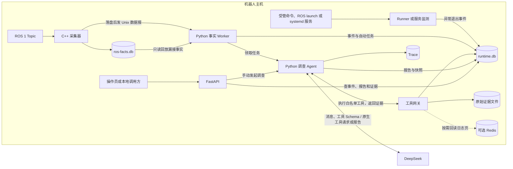
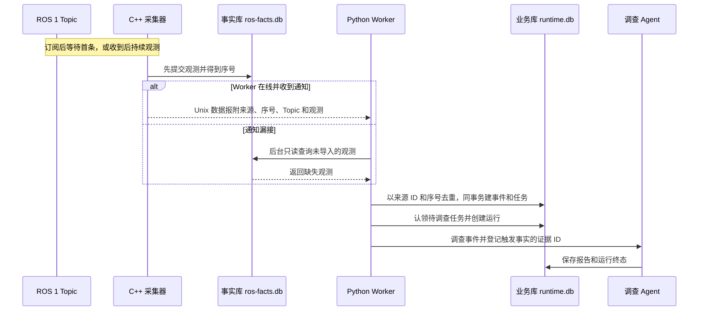
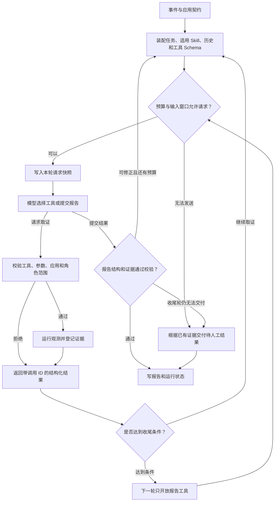
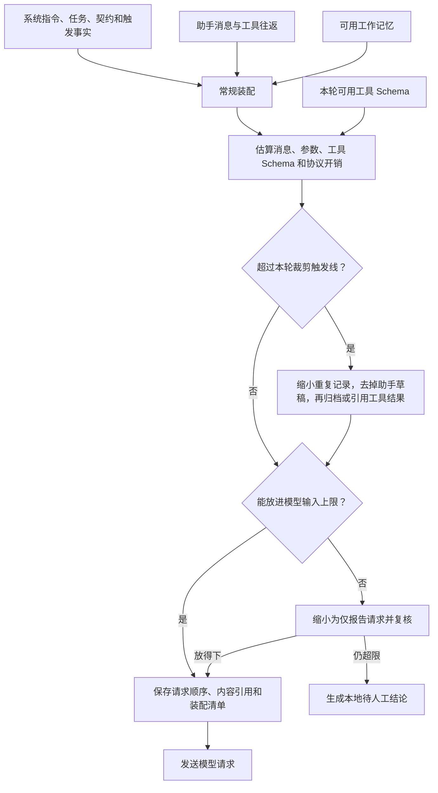
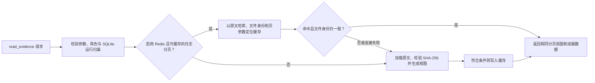
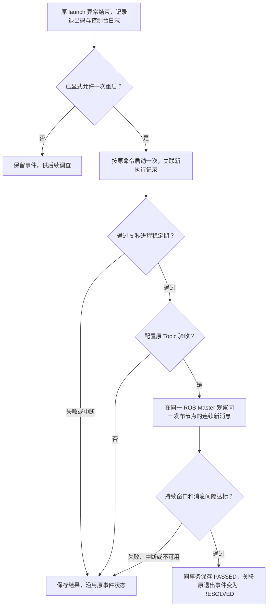

# RobotOps 技术文档

**适用版本** `dev_zjh` 0.5.1，2026 年 11 月 26 日。发布标签 `v0.5.0` 对应此前的 M4 恢复验收和 M5 上下文窗口管理。0.5.1 增加首条 ROS 1 Topic 消息超时、排查 Skill、Redis 日志分页缓存和无额外取证来源时的收尾优化。

[系统架构](#1-系统架构) · [故障数据流](#2-从-topic-异常到报告) · [Agent 循环](#3-agent-如何调查) · [上下文管理](#4-上下文管理) · [存储和缓存](#5-存储和缓存) · [受控恢复](#6-受控恢复与业务验收) · [验证和边界](#7-验证与能力边界) · [面试题](#8-面试常问问题)

## 1. 系统架构

RobotOps 是一个面向机器人应用的本地运维系统。它把「发现异常」「调查原因」「验证恢复」分成可独立核对的步骤。以相机为例，采集器能确认一段时间内没有收到图像 Topic，Agent 根据已有证据说明影响和待查项。若操作员已允许对应 launch 异常退出后重启一次，Runner 会执行原命令，并可用持续到达的新消息验收这次恢复。

| 能力 | 实现 | 主要输入与输出 |
|---|---|---|
| 感知 | C++17、ROS 1 Noetic、SQLite。Python 还监测受管命令、ROS launch 子节点和已登记的 systemd 服务 | 消息到达及进程退出 → 带来源、时间和阈值的事实或退出事件 |
| 调查 | Python、LangGraph、ChatDeepSeek 的原生函数调用、Pydantic | 事件、应用契约、观测和案例 → 有证据引用的诊断报告 |
| 记忆与审计 | SQLite、FTS5、证据文件和 Trace | 工作假设、历史案例、模型可见消息、原文和时序 → 可复核的调查记录 |
| 接入和恢复 | FastAPI、CLI、ROS 1 Runner 和 C++ 验收探针 | 显式配置、进程状态和指定 Topic → 查询结果、一次重启回执、业务验收状态 |

C++ 进程贴近 ROS 回调、时钟和业务信号，能在 Python Worker 重启时继续记录事实。Python 负责接入本地 API、排程、证据归属、提示词和模型预算。两者在单机通过 Unix 数据报通知，事实库提供可回放的数据。应用契约描述组件、依赖与健康阈值，工具网关据此限定每次运行的范围。 [采集器](../cpp/ros1_facts/main.cpp) · [Worker](../src/robotops/ros_facts.py) · [服务入口](../src/robotops/api.py)

## 2. 从 Topic 异常到报告

### 2.1 C++ 如何定义两种异常

采集器订阅一个应用的一个 Topic，记录消息到达时间。在未收到首条消息时，启用了 `--startup-timeout-ms` 才开始首条等待检查。到达阈值时发出一次 `topic_startup_timeout`。收到消息后，改用最后一次到达的时间计算静默，达到停发阈值时发出 `topic_silent`。同一段连续静默只报一次，下一条消息会重新开启计时。耗时用单调时钟，落盘的 UTC 时间戳供跨进程核对。

以 `camera` 的 `/smoke/output` 联调为例。发布节点在线，前 700 ms 没有发送，随后开始发布，再暂停。

| 事实字段 | 首条消息超时 | 开始发布后停发 |
|---|---|---|
| `sequence` | 1 | 2 |
| `kind` | `topic_startup_timeout` | `topic_silent` |
| `last_message_at_ms` | `null` | `1795682437376` |
| `silent_ms` | 700，从订阅开始计时 | 519，从末条消息开始计时 |
| `threshold_ms` | 700 | 500 |

C++ 表 `topic_silences` 存序号、观测时间、末条消息时间、时长和阈值。推送时合并 `source` 的应用、Topic、来源 ID，并根据末条消息时间是否为空写出 `kind`。SQLite 迁移让末条时间可为 `NULL`，同时保留旧记录和自增序号。首条等待阈值、停发阈值和应用契约的业务静默上限各有自己的用途。 [采集与迁移代码](../cpp/ros1_facts/main.cpp) · [Noetic 联调](../tests/test_ros_facts.py)

### 2.2 如何处理漏接和重复

Worker 校验应用和事实结构，将 `(source_id, sequence)` 作为导入的幂等键。实时接收与后台回放共用同一入库逻辑。回放每批最多 32 条，与实时接收并行。待调查任务留在 SQLite，Worker 每次只在内存中派发一个。任务认领、创建运行、事件转入调查在同一事务中完成；同一事件的活跃运行由数据库约束限制。Worker 重启会接手尚未开始的任务，已开始但中断的运行保留现场记录并标记失败，操作员可以再发起调查。 [入库和认领](../src/robotops/storage.py) · [实时接收与回放](../src/robotops/ros_facts.py)

### 2.3 模型实际收到什么

早期首条超时联调的第一轮有两条消息和三个工具。系统消息是只读调查规则与 `ros1-topic-silence` 指引。任务消息包含 `camera` 的应用契约、上述第 1 条观测及其 `evidence_id`。当时的工具是 `read_evidence`、`retrieve_cases` 和 `submit_report`。当前 Worker 在已有完整触发事实、缺少现场观测适配器且无适用案例时首轮只开放 `submit_report`，并在模型任务中仅提供输出静默约束。有适用案例时保留检索与回读工具。

固定模型响应生成了 `needs_human` 报告，摘要为「订阅后没有收到首条消息」。`hypotheses` 将具体原因标为 `unverified`，引用触发事实。`recommended_action` 为 `manual_review`，建议检查发布者。证据接口可回查 `silent_ms=700` 和 `last_message_at_ms=null`。接下来的取证需要区分发布端、上游和接收链路。 [当次请求的数据](RobotOps_上下文管理.md#ros-1-自动调查的首次请求)

## 3. Agent 如何调查

主调查采用 ReAct 风格的 **模型选择动作 → 程序执行工具 → 模型依据观测继续** 循环。LangGraph 管理 `model` 和 `tools` 两个节点。DeepSeek 返回结构化函数名、参数和调用 ID。Python 实现工具、访问控制、状态落盘和结束条件。项目通过 `ChatDeepSeek` 接入原生函数调用，允许模型按证据决定下一步。默认以服务端非思考模式调用，轨迹保存可见响应、工具往返和报告依据。

| 示范工具 | 模型给什么 | 后端返回与限制 |
|---|---|---|
| `inspect_process`、`query_metrics` | 采样工具可指定采样秒数 | 当前实例、计数差、收发速率和在途时长。进程和应用范围由后端绑定 |
| `search_logs`、`get_recent_config_changes` | 日志关键词、时间下界、条数等 | 带观测时间和证据 ID。大型日志先返回最近一页 |
| `read_evidence` | 证据 ID、页起点、条数或字段 | 在本次运行和角色范围内读取，回读沿用原证据身份 |
| `retrieve_cases` | 查询词、关注组件 | SQLite FTS5 检索按应用版本、组件和有效性筛选的经验，供排查参考 |
| `update_working_memory`、`submit_report` | 结构化记忆或报告 | 校验证据引用、组件及字段；记忆写入按模式和预算开放 |

网关统一校验工具白名单和输入 Schema。有效观测带 `ok`，现场不可读取用 `unavailable`，参数或范围有问题用 `error`。不可用观测保留来源，便于理解报告缺了什么信息。报告引用经过运行和角色可见性、原文完整性、目标组件与部分时序断言的校验。历史案例和契约辅助形成假设，确认诊断需要本次现场证据。

**单 Agent 与分支。** API 默认 `single`。手动调查也可以选 `supervised`，主 Agent 给应用、系统子分支分配检查任务。应用分支可看指标、日志和配置，系统分支可查进程。分支用 `submit_finding` 提交发现和可见证据；主 Agent 汇总报告，按需回查。主、子分支共享总预算，主调查保留一轮交报告。 [调查入口](../src/robotops/agent/workflow.py) · [角色与分派](../src/robotops/agent/supervision.py)

**Skill。** 默认 v2 根据事件实际保存的 `topic_silent` 或 `topic_startup_timeout` 加载内置指引，将正文放在系统消息中，轨迹记录名称和 SHA-256。Skill 提供按场景组织的排查步骤，工具权限仍由程序决定。 [Topic Skill](../config/skills/ros1-topic-silence/SKILL.md)

**结束条件。** 手动默认 8 次请求，ROS 自动默认 6 次。连续三批工具结果无新观测会提前收尾，预算末轮只开放报告工具。首轮输入已经包含全部可用的现场证据且无适用案例时，可以直接进入报告模式。正常终止时报告为 `proposed` 或 `needs_human`；达到收尾条件但模型未交出合格报告时，主调查会用已验证的证据生成待人工结论。未进入收尾的模型连接或协议错误也可能把本次运行标为 `FAILED`。 [循环与收尾](../src/robotops/agent/graph.py) · [无进展判定](../src/robotops/agent/recovery.py)

## 4. 上下文管理

### 4.1 四类信息分别怎么用

| 信息 | 举例 | 如何进入下轮 |
|---|---|---|
| 固定指令与当前任务 | 只读边界、应用契约、待查症状、触发证据 | 保留系统与任务消息；适用时加入 Skill |
| 调查消息历史 | 某轮要求采样 1 秒，工具回报生产端约 20 Hz、处理完成速率为 0 | 原生工具往返按调用 ID 配对；较旧的结果可聚合、归档或用证据引用表示 |
| 单次调查的工作记忆 | 活跃假设「处理端在途样本超时」、支持证据、反证、待补取的线程栈 | 长调查或层级调查可写入；按运行、版本保存，模型视图有大小预算 |
| 长期案例库 | 某版本曾发生配置通道不一致，附验证时间和来源 | 通过 FTS5 按需检索，辅助决定下一次需要验证的现场信号 |

工作记忆由模型写入，程序校验引用属于本次运行、对该角色可见、焦点组件在契约中。新版本继续保护已有的关键证据和反证，回执只返回状态、版本和保护引用。默认短单 Agent 调查直接用任务里的契约，并根据已有证据交报告。原始观测由工具单独保存，模型注记中的自然语言仍要与原文核对。 [记忆实现](../src/robotops/agent/memory.py) · [案例库](../src/robotops/retrieval.py)

### 4.2 每轮如何装配、裁剪和回查

1. **常规装配。** 默认 `evidence` 策略保留近期工具配对。重复日志按证据位置和已送出字段去重，旧工具结果可保留精确聚合或引用。若整理视图反而更大，回退到较小的保留历史视图。`full` 和 `rolling` 提供实验对照。
2. **触发裁剪与输入硬上限。** 项目默认的估算输入裁剪阈值为 **131,072 Token**，与模型总窗口分别配置。已知窗口的硬上限按总窗口扣除生成额度计算。DeepSeek Flash 的估算器用历史实报校准，未知端点用 UTF-8 字节代理。供应商的实际输入、输出和缓存 Token 另存。
3. **规则裁剪。** 依序处理重复历史（P4）、公开助手草稿（P3）、工具结果（P2）。系统、任务和当轮提供的工具 Schema 保持完整。最近工具调用与回复继续配对，重要证据尽量保留原文或关键诊断字段。保护的旧证据正文有约 4 KiB 预算，工作记忆模型视图约 8 KiB。每次缩小后重新估算，并尝试留出接近上一批工具结果的空间供后续取证。
4. **极限收尾。** 若组装后仍超出硬上限，改为仅报告请求并再次核对；仍装不下时用现有证据收尾。供应商明确返回窗口超限时，最多再发一次更小的报告请求，计入模型调用预算。
5. **保存最终请求。** 快照保存实际发送的消息和工具定义，不同轮共享相同正文。系统指令与工具定义在 `context_inputs`，其余消息在 `context_messages`。`context_snapshots` 保存顺序、装配清单、内容指纹和记忆引用，查询时按顺序还原。Trace 可定位到本轮快照与证据。 [窗口源码](../src/robotops/agent/context.py) · [完整上下文说明](RobotOps_上下文管理.md)

### 4.3 一个长日志怎样影响下一轮

例如 `search_logs(limit=200)` 获得 200 条日志。原文保存为一份证据，长结果首次向模型提供最近一页。模型需要较早数据时，带同一证据 ID 调用 `read_evidence(offset=0, limit=20, fields=[...])`，再按 `next_offset` 续查。被截去的超长行保留原位置，可用更窄的字段重查。

模型在下一请求中看见两个视图共有的证据 ID 和原始行位置。已送出的字段可以去重，新增字段仍会进入对话。程序用本页实际展示内容对应的原始行判断取证进展，所以改分页字段或重复读同一批行不会延长调查。用户仍可在原始证据接口一次查看 200 条。 [分页与原文](../src/robotops/tools.py) · [进展签名](../src/robotops/agent/recovery.py)

## 5. 存储和缓存

| 位置 | 存什么 | 数据的读取入口 |
|---|---|---|
| `data/ros-facts.db` | C++ 采集器的来源与 Topic 事实。路径由采集器的 `DATABASE` 参数指定 | Worker 用 `--facts-db` 指向同一文件，后台只读回放 |
| `data/runtime.db` | 应用契约、事件、任务、运行、报告、恢复回执、案例、证据索引、工作记忆和快照 | Python API 和 Worker，共用 `ROBOTOPS_DATA_DIR` |
| `data/evidence/` | 普通工具观测的原文 JSON。ROS 触发事实通过证据索引回读任务表里的同一份 JSON | `GET /runs/{run_id}/evidence/{evidence_id}` |
| `data/traces/`、`data/executions/` | 模型、工具及用量轨迹，受管命令的控制台日志 | 调查 Trace 或关联退出事件 |
| 可选 Redis | 已校验的日志分页，只缓存派生页和相应的进展数据 | 工具网关内部，TTL 300 秒，单条最多 64 KiB |

### Redis 命中时省掉了什么

缓存键包含运行和证据索引、原文绝对路径、文件身份和分页参数。命中时仍做 SQLite 归属查询，并确认文件身份，省去打开原文文件、解析 JSON、计算原文哈希和分页。文件变化、缓存未命中或 Redis 不可用时重新读取原文。原始证据接口和报告的证据校验走原文路径。

本机 Redis 5.0.7 用同一份 200 行历史日志，两个固定分页交错回读，每种路径共 840 次。批次平均单查耗时的中位数从 **1.621 ms 降至 0.757 ms，下降 53.3%**。页内容、证据身份和进展判断一致，断连后从原文回读的结果也一致。这个数字对应工具网关里重复读取日志页的耗时。 [配置与测量说明](../README.md#可选-redis-分页缓存) · [缓存实现](../src/robotops/evidence_cache.py)

## 6. 受控恢复与业务验收

ROS launch 的恢复由 Runner 执行，需要操作员启动时指定 `--restart-on-exit`。launch 非零退出，或本机必需节点异常退出并导致该次 launch 结束时，Runner 可用原参数重启一次。普通节点可以由 launch 文件已有的 `respawn` 规则处理。systemd 接入负责读取服务状态、记录退出事件。模型输出供人工判断及核对证据。

M4 的 Topic 探针跳过新连接送达的首条锁存回放。允许间隔取应用契约的 `health.max_output_silence_seconds`，持续窗口至少 5 秒且至少为允许间隔的三倍。消息过疏或切换发布者时重计持续窗口。回执保存发布节点、有效消息数、窗口时长和间隔。带退出码 17 的真实 Noetic 用例验证只重启一次。持续发布的样本在 5,016 ms 内收到 200 条，最大间隔 25 ms，验收通过。间歇输出、锁存回放、发错 Topic 的样本没有通过。

`runs.state=COMPLETED` 表示调查结果已交付，报告可为 `proposed` 或 `needs_human`。恢复使用 `incidents.state=RESOLVED` 表达，由进程稳定和原 Topic 的业务验收决定。已经关单的事件可以继续做只读调查。 [恢复操作](../README.md#验收重启后的原-topic) · [原始验收读数](RobotOps_当前版本汇报.md#m4-重启后的-topic-业务验收)

## 7. 验证与能力边界

| 验证方式 | 已覆盖内容或结果 |
|---|---|
| 固定输入和响应 | 校验工具入参、证据归属、报告引用、未授权恢复、窗口收尾、日志去重及并发任务认领 |
| 真实 ROS 1 Noetic | 当前基线全量 **133 项通过，0 项跳过**。实际启动 ROS Master、发布节点与 C++ 采集器，调查部分用固定模型响应 |
| 真实 DeepSeek 首条消息超时 | 在独立 Noetic 发布器上触发自动调查。优化后，同场景从 4 次请求降至 1 次，实报输入从 12,061 降至 2,093 Token。报告区分 700 ms 采集阈值与 1 秒业务静默上限，保留原始证据和补证建议 |
| 真实 DeepSeek 停发调查 | `v0.4.0` 在 Worker 补录停发事实后用了 3 次请求，输入 7,405 Token、输出 2,177 Token，交付含触发证据引用的报告 |
| 真实 DeepSeek 长日志调查 | 隔离 UDP 处理停滞场景，首次日志预览修复后实报输入从 260,190 降到 85,134 Token。另一次基于同批现场数据的纠错请求后，总输入 113,212 Token。两次调查的工具轨迹有差异 |
| 离线装配性能对照 | 11 份真实历史请求 × 三种装配策略 × 两档阈值共 66 组，消息、清单和估算结果逐项一致。默认阈值的本机装配 CPU 耗时中位数从 19.20 ms 降至 16.20 ms |
| 本机 Redis 对照 | 同一原文与页参数下，分页热命中下降 53.3%，并验证断连回退。Redis 缓存计量和 DeepSeek 的输入缓存计量各自独立 |

复核一份报告，可以从事件详情读取 `automatic_run_id`，再查报告和对应证据原文。使用 `/trace` 找 `context_sequence`，通过 `/contexts/{sequence}` 核对当轮真正发送的系统指令、消息和工具定义。评测时，确定性边界以断言为准，诊断质量还要核实报告是否被真实观测支持。 [运行与复现](../README.md#测试与实验) · [阶段结果](RobotOps_当前版本汇报.md) · [长日志实测](RobotOps_上下文管理.md#首次日志预览修复后的-deepseek-复跑)

当前版本面向单机 Linux 和 ROS 1 Noetic。C++ 采集器以一个应用的一个 Topic 为观测单元，覆盖首条消息超时和停发，控制台与进程退出由 Python 接入。多 Topic 的关联监测、持续低频但未停发、实时 ROS 进程与指标适配、ROS 2 和生产远程部署属于可扩展方向。本次真实模型场景启用了 Topic Skill，验证了触发、取证和报告链路。Skill 对诊断质量及用量的独立影响需要同场景开关对照。 [首条消息超时实测](RobotOps_当前版本汇报.md#deepseek-首条消息超时实测)

## 8. 面试常问问题

### 适合开场的项目介绍

> RobotOps 是一个机器人应用故障监测与证据诊断系统。我用 C++ 在 ROS 1 侧记录首条 Topic 消息超时和运行中停发，先写 SQLite，再用 Unix Socket 通知 Python。Python 给每次异常建立调查任务，让模型基于契约、只读工具和证据决定排查动作。长调查通过日志分页、证据引用和窗口裁剪控制输入，报告可以逐条回查原始证据。受控重启由 Runner 执行，恢复通过原 Topic 的持续新消息来验收。我用真实 Noetic、DeepSeek 和本机 Redis 分别验证过观测链路、诊断和分页性能。

### 1. 为什么用 C++ 和 Python 两层？C++ 实际做了哪些？

C++ 直接订阅 ROS 1，使用单调时钟测量消息间隔，检测首条超时和停发，以稳定的来源和序号写事实库并异步通知。它还提供重启后的 Topic 验收探针。Python 负责事件管理、模型调用、工具权限、工作记忆和报告。这个划分让检测阈值和恢复验收按确定性的规则运行，同时模型与业务逻辑可独立迭代。

### 2. Unix 数据报丢了会怎样？如何避免回放时又跑一次？

C++ 先写事实库再发数据报。Python 启动和运行期间会只读回放尚未导入的行。实时和回放都按 `(source_id, sequence)` 去重，事件与任务同事务入库，认领与运行创建也同事务提交。这个设计保证重复通知的入库效果幂等。Worker 中断时，已经开始的运行标记失败并留下证据，尚未领取的任务可继续派发。

### 3. 这个系统哪里体现了 Agent？使用了哪些框架能力？

输入相同的故障描述时，模型可以依据现场观测选择不同的工具及参数。例如指标表明生产端仍活跃、处理端没有完成任务时，可以复采指标确认持续性，或检查配置和日志。LangGraph 管理模型与工具节点的状态流转，ChatDeepSeek 发送函数 Schema，项目实现了工具权限、取证、记忆、窗口装配和报告校验。

### 4. 怎么验证 Agent 的分析过程，模型输出为什么可以很短？

用请求快照核对模型拿到了哪些信息，按调用 ID 从 Trace 找到动作和结果，再把报告里的证据引用回查到原文。例如处理端累计完成数不变、同一个在途样本耗时继续增长，可以解释为什么报告定位为处理停滞。可复核的材料是模型可见输出、工具行为和证据链，分析结论集中在最终报告。

### 5. 如何控制上下文长度？131,072 是模型上限吗？

131,072 是项目选择的估算输入裁剪触发线。知道模型总窗口时，还会单独计算输入硬上限。工具先用分页限制长日志视图，装配再去重、处理旧助手文本和归档工具结果，保留系统、任务和工具调用配对。每级重估，预检仍超限时改为仅报告并复核。实际 Token 以供应商回包为准，快照也保留本地估算和裁剪步骤。

### 6. 工作记忆、快照和原始证据为什么都要存？

三者回答的问题不同。工作记忆存本次调查的假设、支持与反对引用和待查事项。快照记录某轮实际发给模型的内容及顺序。原始证据记录现场事实，是报告可复查的依据。快照按内容复用相同消息和工具定义，记忆正文一致时引用已保存版本。模型接收的是有预算的视图，完整原文仍可回查。

### 7. Skill 和工具有什么区别？怎么控制 Skill 不越界？

Skill 是按事实类型选中的排查指引，放进系统消息。工具是后端执行的函数，有独立的 Schema、白名单和证据范围。当前只有入库的真实 Topic 异常事实会命中这个 Skill，人工描述中的关键词单独写出来也不会命中。Skill 版本内容通过名称和指纹追踪，实际可调用工具仍走程序授权。

### 8. SQLite 与 Redis 是怎么配合的？53.3% 可以怎么写进简历？

SQLite 保存证据的归属和原文哈希，原文在文件或任务记录，Redis 保存此前已校验的日志分页。命中时继续查 SQLite，主要节省文件读取、JSON 解析、哈希计算与分页开销。简历可以写「对同一份 200 行日志每条路径回读 840 次，热点分页延迟从 1.621 ms 降至 0.757 ms」。面试时再说明连接失败会回退，以及整次模型调查延迟需要独立测量。

### 9. 如何避免重复工具调用烧 Token？

初始任务直接带契约，默认短调查的工具定义省略契约查询和工作记忆写入。完整日志查询后建立时间覆盖，已查时段复用原证据，同一页反复回读也不会被算成新线索。连续三批无进展进入收尾，预算末轮只有报告工具。指标计数、在途时长或实例确实变化时仍可产生新观测。

### 10. 怎么防止模型写出貌似合理的误判？

先做工具范围、参数、状态和真实来源校验。报告交付时检查引用归属、可见范围和原文，历史案例或契约独自无法支撑一次现场根因断言。对「首个样本就卡死」这类可检验的说法，用组件、实例、计数和时间戳交叉验证。比如原文显示已有四个样本完成，就要求模型修正。对于证据覆盖不到的阻塞机制，报告应给出待查项。

### 11. 为什么进程已经重启，还要检查原 Topic？

进程稳定只说明 launch 在观察期内没有退出。业务恢复需要在同一 ROS Master、指定 Topic 上看到同一发布者持续产生新消息，消息间隔和连续时长都达标。探针跳过首条锁存回放，避免旧消息被当成新输出。只有 `PASSED` 才在保存结果的同一事务里关单，报告完成状态和恢复状态各自独立。

### 12. 下一步如果做持续低频和多 Topic，会如何验证？

先为每个 Topic 明确目标频率、观测窗口和允许抖动，再用真实发布器构造启动慢、持续低频、间歇停发和短时抖动，确定性测试先验证事实生成和去重。Python 再依据应用契约聚合上下游证据，检查模型能否区分上游输入不足和处理端限速。用同一场景做真实模型对照，分别记录漏报、误报、关键证据、请求数和 Token。
